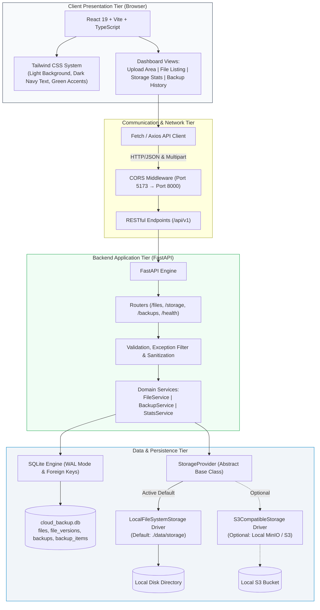

# 🛡️ Cloud Backup System

> **A Self-Hosted, Zero-Cost Cloud Storage & Automated Versioned Backup Platform**  
> Designed as a college capstone project and resume showcase adhering strictly to a **₹0 budget constraint**.

---

## 📌 Project Overview

**Cloud Backup System** is a full-stack, enterprise-grade file storage and backup automation management system. Built to simulate the core capabilities of cloud storage providers (such as AWS S3 or Google Drive), this application eliminates all hosting and cloud subscription fees by operating on local compute and storage while maintaining clean architectural separation.

- **Total Budget**: **₹0 (Zero)** &mdash; No paid cloud accounts, credit cards, or subscription services required.
- **Frontend Architecture**: React 19 + Vite + TypeScript + Tailwind CSS (Light surface, navy text, emerald accents).
- **Backend Architecture**: Python 3 + FastAPI + Uvicorn with asynchronous endpoints and OpenAPI documentation.
- **Persistence Tier**: SQLite 3 with WAL mode for file metadata, immutable versions, audit logs, and backup snapshots.
- **Storage Tier**: Local filesystem backing (default, ₹0 dependencies) with an object-oriented `StorageProvider` abstraction layer plus optional S3-compatible object store driver for **Floci** local AWS emulator (or LocalStack/SeaweedFS).
- **Testing**: `pytest` for backend API, unit, and Floci integration tests (32 passing tests); `vitest` for frontend component verification (14 passing tests).
- **DevOps & CI/CD**: Local Jenkins pipeline (`Jenkinsfile`), Docker multi-stage builds, and Docker Compose for zero-cost build and orchestration automation.

---

## 🔍 Floci Local AWS Emulator & Zero-Cost Compliance Check

| Topic | Analysis & Compliance Status |
| :--- | :--- |
| **Floci Local Emulator** | Licensed under the permissive **MIT License**. Free of charge (₹0), fully open-source local AWS emulator (`floci/floci:2.3.0`) running locally on port **4566**. Unlike proprietary or tiered tools, it requires no credit card, no token activation, and no paid feature tiers. |
| **Persistence Engine** | Configured with `FLOCI_STORAGE_MODE=persistent` and `FLOCI_STORAGE_PERSISTENT_PATH=/app/data`. Writes synchronously to disk in the named Docker volume `cloud_backup_floci_data` so data persists across container restarts. |
| **Python SDK (`boto3`)** | Uses `boto3` licensed under **Apache License 2.0** (permissive, zero-cost, maintained by AWS). Communicates via standard S3 protocol using path-style addressing and local dummy credentials (`test` / `test`). |
| **Default Guarantee** | **All core features operate out of the box with `STORAGE_PROVIDER=local` requiring zero external services or Docker containers.** Floci is strictly an optional local enhancement. |
| **Architectural Scope** | **Floci is a local developer emulator.** It runs on the local host machine and does NOT provide remote cloud deployment, geographical replication, or off-site disaster recovery. |

---

## 📐 System Architecture

The project is structured as a decoupled monorepo with an abstract storage provider layer:



---

## 🗂️ Monorepo Structure

```text
cloud_backup_system/
├── .env.example              # Master environment configuration template
├── .gitignore                # Multi-language Git ignore rules (preserves Jenkinsfile)
├── Jenkinsfile               # Declarative Jenkins CI/CD pipeline skeleton (₹0 local runners)
├── README.md                 # Primary project documentation
├── docs/                     # System design and specifications
│   ├── api_specification.md  # Implemented REST API contracts
│   ├── architecture.md       # Architecture deep-dive, MinIO check, and ER diagram
│   └── phase_plan.md         # 6-phase milestone development roadmap
├── backend/                  # Python 3 + FastAPI Application
│   ├── .env.example          # Backend environment variables template
│   ├── requirements.txt      # Free and maintained Python dependencies
│   ├── app/
│   │   ├── __init__.py
│   │   ├── main.py           # FastAPI entry point, lifespan, CORS, and exception filter
│   │   ├── core/             # Configuration and environment loaders
│   │   │   ├── __init__.py
│   │   │   └── config.py
│   │   ├── db/               # SQLite database manager & relational schemas
│   │   │   ├── __init__.py
│   │   │   └── database.py
│   │   ├── models/           # Pydantic validation and response schemas
│   │   │   ├── __init__.py
│   │   │   └── schemas.py
│   │   ├── routers/          # API route definitions
│   │   │   ├── __init__.py
│   │   │   ├── health.py     # System health and diagnostics
│   │   │   ├── files.py      # Upload, download, list, versions, restore, delete
│   │   │   ├── storage.py    # Capacity metrics and quota stats
│   │   │   └── backups.py    # Backup snapshot trigger and audit history
│   │   ├── services/         # Domain business logic
│   │   │   ├── __init__.py
│   │   │   ├── file_service.py
│   │   │   ├── backup_service.py
│   │   │   └── stats_service.py
│   │   └── storage/          # Storage abstraction drivers
│   │       ├── __init__.py
│   │       ├── base.py       # StorageProvider Abstract Base Class (ABC)
│   │       ├── local.py      # LocalFileSystemStorage driver (atomic, secure)
│   │       └── s3.py         # S3CompatibleStorage driver (MinIO/S3 via boto3)
│   ├── tests/                # Pytest test suite (25 tests passing)
│   │   ├── __init__.py
│   │   ├── conftest.py       # Isolated SQLite & storage fixtures
│   │   ├── test_health.py
│   │   ├── test_storage_interface.py
│   │   ├── test_storage_local.py
│   │   ├── test_storage_s3.py
│   │   ├── test_file_operations.py
│   │   ├── test_security_and_validation.py
│   │   └── test_backups.py
│   └── data/                 # Ignored local persistence directories
│       ├── .gitkeep
│       └── storage/
│           └── .gitkeep
├── frontend/                 # React 19 + Vite + TypeScript + Tailwind CSS
│   ├── .env.example          # Frontend environment variables
│   ├── index.html            # Semantic HTML entry with Inter font
│   ├── package.json          # Node dependencies and build scripts
│   ├── src/                  # React dashboard UI
│   └── tests/                # Frontend Vitest test suite
└── docker/                   # Docker and Compose configurations (Phase 5)
    └── .gitkeep
```

---

## 🚀 Running the Backend (Windows PowerShell)

### 1. Configure Environment
```powershell
# Navigate to backend directory
cd c:\antigravity_projects\cloud_backup_system\backend

# Create your local .env file from the template
Copy-Item .env.example .env
```

### 2. Run All Automated Tests
```powershell
# Execute the full pytest test suite
python -m pytest tests/ -v
```
*Output: 25 passed, 1 skipped (live MinIO skipped when offline), 0 failed.*

### 3. Start the Backend API Server
```powershell
# Launch development server on port 8000
python -m uvicorn app.main:app --host 127.0.0.1 --port 8000 --reload
```

### 4. Inspect Live API Documentation
Once running, open your web browser to:
- **Interactive Swagger Docs**: [http://127.0.0.1:8000/docs](http://127.0.0.1:8000/docs)
- **ReDoc Documentation**: [http://127.0.0.1:8000/redoc](http://127.0.0.1:8000/redoc)
- **Health Check Endpoint**: [http://127.0.0.1:8000/api/v1/health](http://127.0.0.1:8000/api/v1/health)
- **Storage Metrics Endpoint**: [http://127.0.0.1:8000/api/v1/storage/stats](http://127.0.0.1:8000/api/v1/storage/stats)

---

## 💻 Running the Frontend Dashboard (Windows PowerShell)

In a separate PowerShell terminal:

### 1. Configure Environment
```powershell
# Navigate to frontend directory
cd c:\antigravity_projects\cloud_backup_system\frontend

# Ensure local .env exists (default proxies to /api/v1 on backend)
Copy-Item .env.example .env
```

### 2. Run Frontend Automated Tests
```powershell
# Run Vitest component & unit tests
npm.cmd test
```
*Output: 4 test suites passed (14 tests passed), 0 failed.*

### 3. Build Production Bundle
```powershell
# Validate TypeScript types and compile Vite production assets
npm.cmd run build
```

### 4. Start the Frontend Development Server
```powershell
# Launch Vite dev server on port 5173
npm.cmd run dev
```

Open your browser to [http://localhost:5173](http://localhost:5173). The Vite reverse proxy forwards all `/api/*` calls directly to `http://127.0.0.1:8000` with zero CORS issues.

---

## 🖥️ Dashboard Capabilities (Phase 3 Implemented)

- **Storage Metrics Card**: Live visual quota bar (default 50 MB), tracked files counter, active storage engine driver badge (`local` / `s3`), and point-in-time timestamp.
- **Drag-and-Drop Uploader**: Visual drop target, version notes field, pre-upload file size verification (<50 MB), reserved Windows device names filter, and real-time upload status.
- **File Inventory**: Substring search filter, pagination, semantic mime-type icons, active version badge (`v1`, `v2`, etc.), copyable SHA-256 fingerprint, single-click download, and confirmation-guarded deletion.
- **Version Drawer**: Slide-over timeline of historical versions with release notes, creation timestamps, version download action, and one-click rollback/restore with confirmation dialog.
- **System Snapshots**: Manual trigger for system-wide manifest snapshots and point-in-time snapshot audit trail.
- **Graceful Error Recovery**: Live backend heartbeat indicator with automatic reconnect banner and fallback states when the backend is offline.

---

## 🛠️ Execution Modes & Windows PowerShell Run Guide

### Mode A: Local Filesystem Mode (Default, Zero-Dependency, ₹0 Budget)

No Docker or external services required. Everything runs locally on disk.

#### 1. Install Backend Dependencies
```powershell
# Navigate to backend directory
cd c:\antigravity_projects\cloud_backup_system\backend

# Install python dependencies (FastAPI, uvicorn, pydantic, boto3, pytest)
pip install -r requirements.txt
```

#### 2. Start Backend API Server
```powershell
# In Terminal 1:
cd c:\antigravity_projects\cloud_backup_system\backend
$env:STORAGE_PROVIDER="local"
python -m uvicorn app.main:app --host 127.0.0.1 --port 8000 --reload
```
- Health Check: [http://127.0.0.1:8000/api/v1/health](http://127.0.0.1:8000/api/v1/health)
- Interactive Docs: [http://127.0.0.1:8000/docs](http://127.0.0.1:8000/docs)

#### 3. Start Frontend Dashboard
```powershell
# In Terminal 2:
cd c:\antigravity_projects\cloud_backup_system\frontend
npm.cmd run dev
```
- Web Dashboard: [http://localhost:5173](http://localhost:5173)

#### 4. Run Automated Unit & Integration Tests
```powershell
# Run backend test suite (isolated SQLite and mocked storage)
cd c:\antigravity_projects\cloud_backup_system
python -m pytest backend/tests -v

# Run frontend test suite and verify production build
cd c:\antigravity_projects\cloud_backup_system\frontend
npm.cmd test
npm.cmd run build
```

---

### Mode B: Floci Mode (Local AWS/S3-Compatible Storage Emulator)

Uses the free, open-source Floci emulator (`floci/floci:2.3.0`, MIT License, ₹0 budget) running locally on port **4566**.

#### 1. Verify Docker is Running
```powershell
docker --version
docker ps
```

#### 2. Start Floci Service with Persistent Storage
```powershell
# Start Floci via Docker Compose with dedicated persistent volume
cd c:\antigravity_projects\cloud_backup_system
docker compose --profile s3 up -d floci

# Verify Floci health endpoint
Invoke-RestMethod -Uri "http://localhost:4566/_floci/health"
```

#### 3. Start Backend with S3 Storage Selected
```powershell
# In Terminal 1:
cd c:\antigravity_projects\cloud_backup_system\backend
$env:STORAGE_PROVIDER="s3"
$env:S3_ENDPOINT_URL="http://127.0.0.1:4566"
$env:S3_ACCESS_KEY="test"
$env:S3_SECRET_KEY="test"
$env:S3_BUCKET_NAME="cloud-backup-system"
python -m uvicorn app.main:app --host 127.0.0.1 --port 8000 --reload
```
*(The backend's `S3CompatibleStorage` driver automatically and idempotently ensures the bucket `cloud-backup-system` exists).*

#### 4. Start Frontend
```powershell
# In Terminal 2:
cd c:\antigravity_projects\cloud_backup_system\frontend
npm.cmd run dev
```

#### 5. Verify Full Lifecycle (Upload, Versioning, Download, Restore, Snapshot)
You can perform these actions in the browser UI at [http://localhost:5173](http://localhost:5173) or via PowerShell:
```powershell
# 1. Upload initial file (Version 1)
$form = @{ file = Get-Item "README.md" }
Invoke-RestMethod -Uri "http://127.0.0.1:8000/api/v1/files/upload" -Method Post -Form $form

# 2. Upload updated file with same filename (Creates Version 2)
Invoke-RestMethod -Uri "http://127.0.0.1:8000/api/v1/files/upload" -Method Post -Form $form

# 3. Create a point-in-time system backup snapshot
Invoke-RestMethod -Uri "http://127.0.0.1:8000/api/v1/backups/trigger?notes=Verification+Snapshot" -Method Post

# 4. View storage statistics reflecting S3/Floci
Invoke-RestMethod -Uri "http://127.0.0.1:8000/api/v1/storage/stats"
```

#### 6. Test Data Persistence Across Emulator Restart
```powershell
# Restart Floci container
docker restart cloud_backup_floci

# Verify stored objects still exist in Floci after restart (returns 200 with metadata)
Invoke-RestMethod -Uri "http://127.0.0.1:8000/api/v1/storage/stats"
```

#### 7. Stop Containers Without Deleting Persistent Volumes
```powershell
# Stop containers (preserves cloud_backup_floci_data and cloud_backup_backend_data volumes)
docker compose stop

# Do NOT run 'docker compose down -v' unless you explicitly want to purge all stored data!
```

---

### Mode C: Full Multi-Container Docker Compose Stack

Run the entire platform (Frontend + Backend + Floci) inside Docker:

```powershell
cd c:\antigravity_projects\cloud_backup_system

# Validate compose configuration
docker compose --profile s3 config

# Build and start all three containers locally
docker compose --profile s3 up -d --build

# View running container status
docker compose ps

# Access application
# - Web Dashboard:  http://localhost:5173
# - REST API Docs:  http://localhost:8000/docs
# - Floci S3 Edge:  http://localhost:4566/_floci/health

# Stop without destroying data
docker compose stop
```

---

## 🔒 Security & Scope Limitations

1. **Path Traversal Protection**: Directory traversal (`../../`) and absolute paths are rejected.
2. **Device Name Filter**: Windows reserved filenames (`CON`, `PRN`, `AUX`, `NUL`, etc.) are blocked.
3. **Immutable History**: Historical object keys cannot be overwritten. Uploading a revised file creates a new unique key and increments the version counter.
4. **Data Isolation**: Internal disk paths are masked in API outputs.
5. **Scope Notice**: Designed as a single-user local demonstration system without multi-user authentication.
