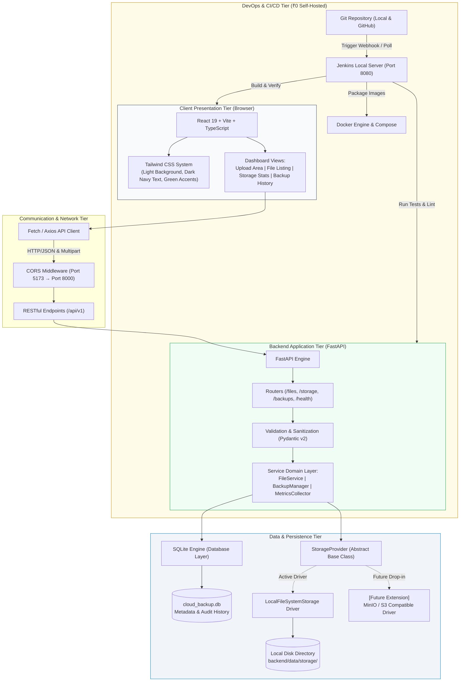

# 🛡️ Cloud Backup System

> **A Self-Hosted, Zero-Cost Cloud Storage & Automated Backup Platform**  
> Designed as a college capstone project and resume showcase adhering strictly to a **₹0 budget constraint**.

---

## 📌 Project Overview

**Cloud Backup System** is a full-stack, enterprise-grade file storage and backup automation management system. Built to simulate the core capabilities of cloud storage providers (such as AWS S3 or Google Drive), this application eliminates all hosting and cloud subscription fees by operating on local compute and storage while maintaining clean architectural separation.

- **Total Budget**: **₹0 (Zero)** &mdash; No paid cloud accounts, credit cards, or subscription services required.
- **Frontend Architecture**: React 19 + Vite + TypeScript + Tailwind CSS (Light surface, navy text, emerald accents).
- **Backend Architecture**: Python 3 + FastAPI + Uvicorn with asynchronous endpoints and OpenAPI documentation.
- **Persistence Tier**: SQLite 3 with WAL mode for file metadata, audit logs, and backup snapshots.
- **Storage Tier**: Local filesystem backing with an object-oriented `StorageProvider` abstraction layer ready for future pluggable object store drivers (MinIO, S3).
- **Testing**: `pytest` for backend API and unit tests; `vitest` + React Testing Library for frontend component verification.
- **DevOps & CI/CD**: Local Jenkins pipeline (`Jenkinsfile`), Docker, and Docker Compose for zero-cost build automation.

---

## 📐 System Architecture

The project is structured as a decoupled monorepo with an abstract storage provider layer:



---

## 🗂️ Monorepo Structure

```text
cloud_backup_system/
├── .env.example              # Master environment configuration template
├── .gitignore                # Multi-language Git ignore rules (preserves Jenkinsfile)
├── Jenkinsfile               # Declarative Jenkins CI/CD pipeline skeleton (₹0 local runners)
├── README.md                 # Primary project documentation
├── docs/                     # System design and specifications
│   ├── api_specification.md  # REST API endpoint contracts
│   ├── architecture.md       # Architectural deep-dive and component diagrams
│   └── phase_plan.md         # Phased milestone development roadmap
├── backend/                  # Python 3 + FastAPI Application
│   ├── .env.example          # Backend environment variables
│   ├── requirements.txt      # Free and maintained Python dependencies
│   ├── app/
│   │   ├── __init__.py
│   │   ├── main.py           # FastAPI entry point with CORS and lifespan hooks
│   │   ├── core/             # Configuration and environment loaders
│   │   │   ├── __init__.py
│   │   │   └── config.py
│   │   ├── db/               # SQLite database manager & schemas
│   │   │   ├── __init__.py
│   │   │   └── database.py
│   │   ├── routers/          # API route definitions
│   │   │   ├── __init__.py
│   │   │   └── health.py     # Health and diagnostic router
│   │   └── storage/          # Pluggable storage abstraction
│   │       ├── __init__.py
│   │       └── base.py       # StorageProvider Abstract Base Class (ABC)
│   ├── tests/                # Pytest test suite
│   │   ├── __init__.py
│   │   ├── conftest.py       # Test fixtures and HTTP client
│   │   ├── test_health.py    # Health check tests
│   │   └── test_storage_interface.py # Storage contract verification
│   └── data/                 # Ignored local persistence directories
│       ├── .gitkeep
│       └── storage/
│           └── .gitkeep
├── frontend/                 # React 19 + Vite + TypeScript + Tailwind CSS
│   ├── .env.example          # Frontend environment variables
│   ├── index.html            # Semantic HTML entry with Inter font
│   ├── package.json          # Node dependencies and build scripts
│   ├── postcss.config.js     # PostCSS Tailwind processor
│   ├── tailwind.config.js    # Theme tokens (Light bg, dark navy, green accents)
│   ├── tsconfig.json         # TypeScript configurations
│   ├── tsconfig.app.json
│   ├── tsconfig.node.json
│   ├── vite.config.ts        # Vite build config with backend API proxy
│   ├── src/
│   │   ├── App.tsx           # Dashboard UI shell adhering to design goal
│   │   ├── index.css         # Tailwind directives & CSS variables
│   │   ├── main.tsx          # React DOM entry point
│   │   └── types/
│   │       └── index.ts      # Shared TypeScript data models
│   └── tests/                # Frontend Vitest test suite
│       ├── App.test.tsx      # Dashboard rendering tests
│       └── setup.ts          # Jest-DOM matchers setup
└── docker/                   # Docker and Compose configurations (Phase 5)
    └── .gitkeep
```

---

## 🚀 Getting Started (Windows PowerShell)

### Prerequisites Check
Ensure the following free tools are installed on your Windows machine:
- **Python**: 3.10+ (`python --version`)
- **Node.js**: 20+ (`node --version`)
- **Git**: 2.30+ (`git --version`)
- **Docker**: (Optional for Phase 1, required in Phase 5)

> **💡 PowerShell Note**: On Windows systems where script execution policies restrict `.ps1` execution, use `npm.cmd` and `npx.cmd` directly.

### 1. Backend Setup
Open a Windows PowerShell terminal in the repository root:

```powershell
# Navigate to backend directory
cd backend

# Create a virtual environment
python -m venv .venv

# Activate the virtual environment
.\.venv\Scripts\Activate.ps1
# (Or if script execution is restricted: .\.venv\Scripts\activate.bat)

# Upgrade pip and install dependencies
python -m pip install --upgrade pip
python -m pip install -r requirements.txt

# Copy environment template
Copy-Item .env.example .env

# Run unit tests with pytest
python -m pytest tests/ -v

# Start development server
python -m uvicorn app.main:app --host 127.0.0.1 --port 8000 --reload
```
The backend API is now accessible at `http://127.0.0.1:8000` with interactive Swagger docs at `http://127.0.0.1:8000/docs`.

### 2. Frontend Setup
Open a second Windows PowerShell terminal:

```powershell
# Navigate to frontend directory
cd frontend

# Copy environment template
Copy-Item .env.example .env

# Install Node dependencies (using npm.cmd for PowerShell safety)
npm.cmd install

# Run frontend test suite
npm.cmd test

# Start the Vite development server
npm.cmd run dev
```
Open your browser at `http://localhost:5173` to explore the dashboard.

---

## 🗺️ Development Phasing Plan

| Phase | Milestone | Status | Key Deliverables |
| :---: | :--- | :---: | :--- |
| **Phase 1** | **Foundation & Setup** | **Completed** | Monorepo layout, .gitignore, safe configs, storage ABC, docs, Jenkinsfile. |
| **Phase 2** | **Backend Core & Storage Engine** | Next | SQLite migrations, LocalFileSystem driver, file upload, download & backup APIs. |
| **Phase 3** | **Frontend UI & Integration** | Pending | Responsive dashboard, upload drag & drop, file inventory, backup audit UI. |
| **Phase 4** | **Testing & Quality Assurance** | Pending | Comprehensive pytest and vitest test coverage, integration tests. |
| **Phase 5** | **Docker & Jenkins CI/CD** | Pending | Multi-container Docker Compose, local Jenkins pipeline execution. |
| **Phase 6** | **Project Defense & Documentation** | Pending | Academic project report, presentation slides, resume showcase brief. |

---

## 🔒 Security & Best Practices

1. **Path Traversal Protection**: Uploaded files will be stored using unique UUID tokens on disk, shielding filesystem hierarchies from arbitrary filename injection.
2. **Deterministic Checksums**: SHA-256 digests are computed during upload to ensure end-to-end file integrity and deduplication.
3. **Environment Isolation**: No credentials or private paths are tracked in Git. All settings are parameterized through `.env` files.
4. **CORS Hardening**: Strict CORS origins restrict browser access exclusively to configured local endpoints.

---

## 📜 License & Academic Integrity

This project is developed for educational and resume demonstration purposes. Distributed under the MIT Open Source License.
