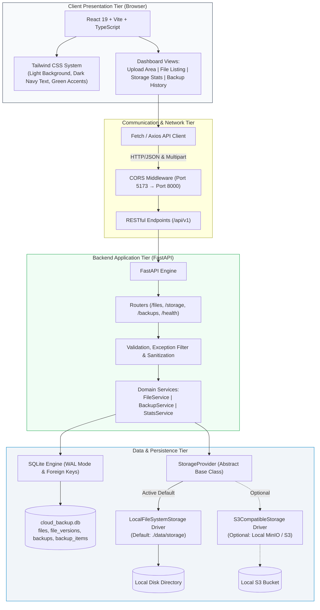

# 🛡️ Cloud Backup System

> **A Self-Hosted, Zero-Cost Cloud Storage & Automated Versioned Backup Platform**  
> Designed as a college capstone project and resume showcase adhering strictly to a **₹0 budget constraint**.

---

## 📌 Project Overview

**Cloud Backup System** is a full-stack, enterprise-grade file storage and backup automation management system. Built to simulate the core capabilities of cloud storage providers (such as AWS S3 or Google Drive), this application eliminates all hosting and cloud subscription fees by operating on local compute and storage while maintaining clean architectural separation.

- **Total Budget**: **₹0 (Zero)** &mdash; No paid cloud accounts, credit cards, or subscription services required.
- **Frontend Architecture**: React 19 + Vite + TypeScript + Tailwind CSS (Light surface, navy text, emerald accents).
- **Backend Architecture**: Python 3 + FastAPI + Uvicorn with asynchronous endpoints and OpenAPI documentation.
- **Persistence Tier**: SQLite 3 with WAL mode for file metadata, immutable versions, audit logs, and backup snapshots.
- **Storage Tier**: Local filesystem backing (default, ₹0 dependencies) with an object-oriented `StorageProvider` abstraction layer plus optional S3-compatible object store driver for **Floci** local AWS emulator (or LocalStack/SeaweedFS).
- **Testing**: `pytest` for backend API, unit, E2E smoke, archive recovery, and Floci integration tests (43 passed, 2 skipped when Floci offline); `vitest` for frontend component verification (19 passed across 5 test suites).
- **Portable Backup Archives (Phase 7)**: Independently restorable standard ZIP archives with root `manifest.json` (v1.0.0), binary payloads, SHA-256 integrity verification, and safe conflict strategies.
- **DevOps & CI/CD**: Local Jenkins pipeline (`Jenkinsfile`), Docker multi-stage builds, and Docker Compose for zero-cost build and orchestration automation.

---

## 🔍 Floci Local AWS Emulator & Zero-Cost Compliance Check

| Topic | Analysis & Compliance Status |
| :--- | :--- |
| **Floci Local Emulator** | Licensed under the permissive **MIT License**. Free of charge (₹0), fully open-source local AWS emulator (`floci/floci:2.3.0`) running locally on port **4566**. Unlike proprietary or tiered tools, it requires no credit card, no token activation, and no paid feature tiers. |
| **Persistence Engine** | Configured with `FLOCI_STORAGE_MODE=persistent` and `FLOCI_STORAGE_PERSISTENT_PATH=/app/data`. Writes synchronously to disk in the named Docker volume `cloud_backup_floci_data` so data persists across container restarts. |
| **Python SDK (`boto3`)** | Uses `boto3` licensed under **Apache License 2.0** (permissive, zero-cost, maintained by AWS). Communicates via standard S3 protocol using path-style addressing and local dummy credentials (`test` / `test`). |
| **Default Guarantee** | **All core features operate out of the box with `STORAGE_PROVIDER=local` requiring zero external services or Docker containers.** Floci is strictly an optional local enhancement. |
| **Architectural Scope** | **Floci is a local developer emulator.** It runs on the local host machine and does NOT provide remote cloud deployment, geographical replication, or off-site disaster recovery. |

---

## 📐 System Architecture

The project is structured as a decoupled monorepo with an abstract storage provider layer:



---

## 🗂️ Monorepo Structure

```text
cloud_backup_system/
├── .env.example              # Master environment configuration template
├── .gitignore                # Multi-language Git ignore rules (preserves Jenkinsfile)
├── Jenkinsfile               # Declarative Jenkins CI/CD pipeline skeleton (₹0 local runners)
├── README.md                 # Primary project documentation
├── docs/                     # System design and specifications
│   ├── api_specification.md  # Implemented REST API contracts
│   ├── architecture.md       # Architecture deep-dive, MinIO check, and ER diagram
│   ├── jenkins-ci-cd.md      # Jenkins CI/CD pipeline architecture and setup guide
│   └── phase_plan.md         # 6-phase milestone development roadmap
├── scripts/                  # Automated Windows PowerShell workflows
│   ├── start-local.ps1       # Local development environment launcher
│   └── smoke-test.ps1        # 10-step end-to-end API smoke verification
├── backend/                  # Python 3 + FastAPI Application
│   ├── .env.example          # Backend environment variables template
│   ├── requirements.txt      # Free and maintained Python dependencies
│   ├── app/
│   │   ├── __init__.py
│   │   ├── main.py           # FastAPI entry point, lifespan, CORS, and exception filter
│   │   ├── core/             # Configuration and environment loaders
│   │   │   ├── __init__.py
│   │   │   └── config.py
│   │   ├── db/               # SQLite database manager & relational schemas
│   │   │   ├── __init__.py
│   │   │   └── database.py
│   │   ├── models/           # Pydantic validation and response schemas
│   │   │   ├── __init__.py
│   │   │   └── schemas.py
│   │   ├── routers/          # API route definitions
│   │   │   ├── __init__.py
│   │   │   ├── health.py     # System health and diagnostics
│   │   │   ├── files.py      # Upload, download, list, versions, restore, delete
│   │   │   ├── storage.py    # Capacity metrics and quota stats
│   │   │   └── backups.py    # Backup snapshot trigger and audit history
│   │   ├── services/         # Domain business logic
│   │   │   ├── __init__.py
│   │   │   ├── file_service.py
│   │   │   ├── backup_service.py
│   │   │   └── stats_service.py
│   │   └── storage/          # Storage abstraction drivers
│   │       ├── __init__.py
│   │       ├── base.py       # StorageProvider Abstract Base Class (ABC)
│   │       ├── local.py      # LocalFileSystemStorage driver (atomic, secure)
│   │       └── s3.py         # S3CompatibleStorage driver (MinIO/S3 via boto3)
│   ├── tests/                # Pytest test suite (25 tests passing)
│   │   ├── __init__.py
│   │   ├── conftest.py       # Isolated SQLite & storage fixtures
│   │   ├── test_health.py
│   │   ├── test_storage_interface.py
│   │   ├── test_storage_local.py
│   │   ├── test_storage_s3.py
│   │   ├── test_file_operations.py
│   │   ├── test_security_and_validation.py
│   │   └── test_backups.py
│   └── data/                 # Ignored local persistence directories
│       ├── .gitkeep
│       └── storage/
│           └── .gitkeep
├── frontend/                 # React 19 + Vite + TypeScript + Tailwind CSS
│   ├── .env.example          # Frontend environment variables
│   ├── index.html            # Semantic HTML entry with Inter font
│   ├── package.json          # Node dependencies and build scripts
│   ├── src/                  # React dashboard UI
│   └── tests/                # Frontend Vitest test suite
└── docker/                   # Docker and Compose configurations (Phase 5)
    └── .gitkeep
```

---

## 🚀 Running the Backend (Windows PowerShell)

### 1. Configure Environment
```powershell
# Navigate to backend directory
cd c:\antigravity_projects\cloud_backup_system\backend

# Create your local .env file from the template
Copy-Item .env.example .env
```

### 2. Run All Automated Tests
```powershell
# Execute the full pytest test suite
python -m pytest tests/ -v
```
*Output: 25 passed, 1 skipped (live MinIO skipped when offline), 0 failed.*

### 3. Start the Backend API Server
```powershell
# Launch development server on port 8000
python -m uvicorn app.main:app --host 127.0.0.1 --port 8000 --reload
```

### 4. Inspect Live API Documentation
Once running, open your web browser to:
- **Interactive Swagger Docs**: [http://127.0.0.1:8000/docs](http://127.0.0.1:8000/docs)
- **ReDoc Documentation**: [http://127.0.0.1:8000/redoc](http://127.0.0.1:8000/redoc)
- **Health Check Endpoint**: [http://127.0.0.1:8000/api/v1/health](http://127.0.0.1:8000/api/v1/health)
- **Storage Metrics Endpoint**: [http://127.0.0.1:8000/api/v1/storage/stats](http://127.0.0.1:8000/api/v1/storage/stats)

---

## 💻 Running the Frontend Dashboard (Windows PowerShell)

In a separate PowerShell terminal:

### 1. Configure Environment
```powershell
# Navigate to frontend directory
cd c:\antigravity_projects\cloud_backup_system\frontend

# Ensure local .env exists (default proxies to /api/v1 on backend)
Copy-Item .env.example .env
```

### 2. Run Frontend Automated Tests
```powershell
# Run Vitest component & unit tests
npm.cmd test
```
*Output: 4 test suites passed (14 tests passed), 0 failed.*

### 3. Build Production Bundle
```powershell
# Validate TypeScript types and compile Vite production assets
npm.cmd run build
```

### 4. Start the Frontend Development Server
```powershell
# Launch Vite dev server on port 5173
npm.cmd run dev
```

Open your browser to [http://localhost:5173](http://localhost:5173). The Vite reverse proxy forwards all `/api/*` calls directly to `http://127.0.0.1:8000` with zero CORS issues.

---

## 🖥️ Dashboard Capabilities (Phase 3 Implemented)

- **Storage Metrics Card**: Live visual quota bar (default 50 MB), tracked files counter, active storage engine driver badge (`local` / `s3`), and point-in-time timestamp.
- **Drag-and-Drop Uploader**: Visual drop target, version notes field, pre-upload file size verification (<50 MB), reserved Windows device names filter, and real-time upload status.
- **File Inventory**: Substring search filter, pagination, semantic mime-type icons, active version badge (`v1`, `v2`, etc.), copyable SHA-256 fingerprint, single-click download, and confirmation-guarded deletion.
- **Version Drawer**: Slide-over timeline of historical versions with release notes, creation timestamps, version download action, and one-click rollback/restore with confirmation dialog.
- **System Snapshots**: Manual trigger for system-wide manifest snapshots and point-in-time snapshot audit trail.
- **Graceful Error Recovery**: Live backend heartbeat indicator with automatic reconnect banner and fallback states when the backend is offline.

---

## 🛠️ Execution Modes & Windows PowerShell Run Guide

### Mode A: Local Filesystem Mode (Default, Zero-Dependency, ₹0 Budget)

No Docker or external services required. Everything runs locally on disk.

#### 1. Install Backend Dependencies
```powershell
# Navigate to backend directory
cd c:\antigravity_projects\cloud_backup_system\backend

# Install python dependencies (FastAPI, uvicorn, pydantic, boto3, pytest)
pip install -r requirements.txt
```

#### 2. Start Backend API Server
```powershell
# In Terminal 1:
cd c:\antigravity_projects\cloud_backup_system\backend
$env:STORAGE_PROVIDER="local"
python -m uvicorn app.main:app --host 127.0.0.1 --port 8000 --reload
```
- Health Check: [http://127.0.0.1:8000/api/v1/health](http://127.0.0.1:8000/api/v1/health)
- Interactive Docs: [http://127.0.0.1:8000/docs](http://127.0.0.1:8000/docs)

#### 3. Start Frontend Dashboard
```powershell
# In Terminal 2:
cd c:\antigravity_projects\cloud_backup_system\frontend
npm.cmd run dev
```
- Web Dashboard: [http://localhost:5173](http://localhost:5173)

#### 4. Run Automated Unit & Integration Tests
```powershell
# Run backend test suite (isolated SQLite and mocked storage)
cd c:\antigravity_projects\cloud_backup_system
python -m pytest backend/tests -v

# Run frontend test suite and verify production build
cd c:\antigravity_projects\cloud_backup_system\frontend
npm.cmd test
npm.cmd run build
```

---

### Mode B: Floci Mode (Local AWS/S3-Compatible Storage Emulator)

Uses the free, open-source Floci emulator (`floci/floci:2.3.0`, MIT License, ₹0 budget) running locally on port **4566**.

#### 1. Verify Docker is Running
```powershell
docker --version
docker ps
```

#### 2. Start Floci Service with Persistent Storage
```powershell
# Start Floci via Docker Compose with dedicated persistent volume
cd c:\antigravity_projects\cloud_backup_system
docker compose --profile s3 up -d floci

# Verify Floci health endpoint
Invoke-RestMethod -Uri "http://localhost:4566/_floci/health"
```

#### 3. Start Backend with S3 Storage Selected
```powershell
# In Terminal 1:
cd c:\antigravity_projects\cloud_backup_system\backend
$env:STORAGE_PROVIDER="s3"
$env:S3_ENDPOINT_URL="http://127.0.0.1:4566"
$env:S3_ACCESS_KEY="test"
$env:S3_SECRET_KEY="test"
$env:S3_BUCKET_NAME="cloud-backup-system"
python -m uvicorn app.main:app --host 127.0.0.1 --port 8000 --reload
```
*(The backend's `S3CompatibleStorage` driver automatically and idempotently ensures the bucket `cloud-backup-system` exists).*

#### 4. Start Frontend
```powershell
# In Terminal 2:
cd c:\antigravity_projects\cloud_backup_system\frontend
npm.cmd run dev
```

#### 5. Verify Full Lifecycle (Upload, Versioning, Download, Restore, Snapshot)
You can perform these actions in the browser UI at [http://localhost:5173](http://localhost:5173) or via PowerShell:
```powershell
# 1. Upload initial file (Version 1)
$form = @{ file = Get-Item "README.md" }
Invoke-RestMethod -Uri "http://127.0.0.1:8000/api/v1/files/upload" -Method Post -Form $form

# 2. Upload updated file with same filename (Creates Version 2)
Invoke-RestMethod -Uri "http://127.0.0.1:8000/api/v1/files/upload" -Method Post -Form $form

# 3. Create a point-in-time system backup snapshot
Invoke-RestMethod -Uri "http://127.0.0.1:8000/api/v1/backups/trigger?notes=Verification+Snapshot" -Method Post

# 4. View storage statistics reflecting S3/Floci
Invoke-RestMethod -Uri "http://127.0.0.1:8000/api/v1/storage/stats"
```

#### 6. Test Data Persistence Across Emulator Restart
```powershell
# Restart Floci container
docker restart cloud_backup_floci

# Verify stored objects still exist in Floci after restart (returns 200 with metadata)
Invoke-RestMethod -Uri "http://127.0.0.1:8000/api/v1/storage/stats"
```

#### 7. Stop Containers Without Deleting Persistent Volumes
```powershell
# Stop containers (preserves cloud_backup_floci_data and cloud_backup_backend_data volumes)
docker compose stop

# Do NOT run 'docker compose down -v' unless you explicitly want to purge all stored data!
```

---

### Mode C: Full Multi-Container Docker Compose Stack

Run the entire platform (Frontend + Backend + Floci) inside Docker:

```powershell
cd c:\antigravity_projects\cloud_backup_system

# Validate compose configuration
docker compose --profile s3 config

# Build and start all three containers locally
docker compose --profile s3 up -d --build

# View running container status
docker compose ps

# Access application
# - Web Dashboard:  http://localhost:5173
# - REST API Docs:  http://localhost:8000/docs
# - Floci S3 Edge:  http://localhost:4566/_floci/health

# Stop without destroying data
docker compose stop
```

---

## 🧪 End-to-End Smoke Test & Verification Workflows

The Cloud Backup System includes two automated, reproducible verification workflows covering all 10 core lifecycle operations:

1. **System Health & Dependency Check** &mdash; Validates SQLite connection and active storage driver.
2. **Initial File Upload (v1)** &mdash; Computes SHA-256, assigns immutable key, and registers version 1.
3. **Catalog Listing & Lookup** &mdash; Verifies file indexing and substring search.
4. **File Download & Content Verification** &mdash; Validates downloaded bytes match original SHA-256.
5. **Second Version Upload (v2)** &mdash; Increments version number while preserving immutable past version.
6. **Historical Version Download** &mdash; Retrieves v1 by `version_id` query parameter.
7. **Version Rollback / Restore** &mdash; Atomically rolls back active pointer to v1.
8. **Point-in-Time Backup Snapshot** &mdash; Computes deterministic manifest checksum and records in audit history.
9. **File Deletion & Storage Purge** &mdash; Purges metadata and removes physical blobs from storage.
10. **Graceful Storage Failure Handling** &mdash; Confirms clean 500 error when storage backend is unavailable, preventing silent local disk fallback.

### Option 1: Automated Pytest E2E Suite (Zero Running Services Required)
Runs against an isolated in-memory/temporary SQLite database and storage directory:
```powershell
python -m pytest backend/tests/test_smoke_e2e.py -v
```

### Option 2: Live PowerShell Smoke Test (Runs Against Live API)
With the backend running locally (`http://127.0.0.1:8000`):
```powershell
.\scripts\smoke-test.ps1
```
*(Uses temporary UUID-tagged files and cleans up automatically without modifying existing user files or SQLite databases).*

---

## 💾 Backup Semantics, Recovery Model & Limitations

To ensure complete transparency for college defense, technical review, and disaster recovery audits, the system differentiates between **Point-in-Time Metadata Snapshots** (Phase 2) and **Portable Backup Archives** (Phase 7):

### 1. Metadata Snapshots vs. Portable Backup Archives

| Architectural Dimension | Metadata Snapshots (Phase 2) | Portable Backup Archives (Phase 7) |
| :--- | :--- | :--- |
| **Storage Medium** | SQLite `backups` & `backup_items` relational tables. | Standard `.zip` binary archive with root `manifest.json`. |
| **Contents** | References (`file_id`, `version_id`), individual SHA-256 hashes, sizes, aggregate checksum. | Complete raw binary payloads for all active files & historical versions under `blobs/`, plus format v1.0.0 manifest. |
| **Payload Duplication** | Zero payload duplication. Fast, zero-overhead point-in-time state capture. | Self-contained. Copies required versions from storage backend into ZIP. |
| **Independence** | Dependent on existing backend storage (`./data/storage` or Floci S3) and SQLite database. | **100% Independent**. Restorable onto clean, isolated installations without the original database or file paths. |
| **Primary Use Case** | Point-in-time state auditing, instantaneous version rollback, change tracking. | Full disaster recovery, hardware migrations, external cold storage, and offline portability. |

---

### 2. Portable Backup Archive Format Specification (v1.0.0)

A portable backup archive is an unencrypted, standardized ZIP archive generated using Python's standard library (`zipfile`, `hashlib`, `json`). It adheres strictly to format version `1.0.0`:

```text
backup_archive_20261024_030000.zip
├── manifest.json                  # Root cryptographic manifest (v1.0.0)
└── blobs/
    ├── {version_id_1}_report.pdf  # Raw payload bytes for File 1, Version 1
    ├── {version_id_2}_report.pdf  # Raw payload bytes for File 1, Version 2
    └── {version_id_3}_data.csv    # Raw payload bytes for File 2, Version 1
```

- **Manifest Metadata**: Root `manifest.json` specifies `archive_format_version: "1.0.0"`, `generator: "CloudBackupSystem/1.0.0"`, `exported_at`, `total_files`, `total_versions`, `total_bytes`, and the files array.
- **File & Version Relationships**: Each entry records `original_filename`, `safe_filename`, `content_type`, `current_version_number`, `total_versions`, and ordered `versions` with `archive_blob_path`, `size_bytes`, `sha256`, `change_summary`, and `is_current`.
- **Policy on Missing Blobs**: If any underlying version blob is missing from storage, the export immediately aborts with `HTTP 409 Conflict`. **The system never outputs a truncated or incomplete backup while claiming success.**
- **Secret Exclusion**: Archives strictly package user files and metadata. Application secrets, `.env` files, JWT tokens, SQLite database files, and operating system paths are categorically excluded.

---

### 3. Security, Defenses & Conflict Handling

- **Path Traversal Defense**: Zip entries with absolute paths, drive letters (`C:`), or directory traversals (`../`) are detected and rejected during verification.
- **Windows Reserved Device Names**: Filenames matching `CON`, `PRN`, `AUX`, `NUL`, `COM1-9`, `LPT1-9` are rejected.
- **Decompression Bomb Mitigation**:
  - Max archive upload size: **100 MB**.
  - Max total uncompressed payload: **250 MB**.
  - Max entry count: **1,000 entries**.
  - Max compression ratio: **100:1**.
- **Cryptographic Pre-Verification**: Verification and restore operations compute the SHA-256 digest of every uncompressed blob and match it against `manifest.json` before any database or storage mutations are made.
- **Zero-Trust Identifiers**: Archive UUIDs are never trusted. During restoration, fresh internal system UUIDs and storage keys are generated.
- **Storage Rollback**: If a database error occurs during restore, newly written storage objects are rolled back and purged to prevent disk clutter.
- **Conflict Resolution Strategies**:
  - `rename` *(Default)*: Safely appends `_imported_{short_uuid}` to conflicting filenames. Existing files and historical versions remain untouched.
  - `skip`: Skips files that already exist in the target system. Only new files are imported.
  - `replace`: Atomically removes colliding existing files and all their historical versions, replacing them with the archive's versions.

---

### 4. PowerShell Commands: Export, Verify & Restore

All archive operations can be executed directly from Windows PowerShell using `Invoke-RestMethod` or `curl.exe`:

#### Step A: Export Archive (.zip)
```powershell
# Export archive with audit notes to a local ZIP file
Invoke-RestMethod -Uri "http://127.0.0.1:8000/api/v1/archives/export?notes=Monthly+Offline+Backup" `
  -Method GET `
  -OutFile "C:\temp\backup_archive.zip"

Write-Host "Archive exported successfully to C:\temp\backup_archive.zip"
```

#### Step B: Verify Archive Integrity (Dry-Run Check)
```powershell
# Inspect archive structure, zip limits, and SHA-256 checksums without modifying state
$filePath = "C:\temp\backup_archive.zip"
$form = @{
  file = Get-Item -Path $filePath
}
$verifyResult = Invoke-RestMethod -Uri "http://127.0.0.1:8000/api/v1/archives/verify" `
  -Method POST `
  -Form $form

# Display verification summary
$verifyResult | Format-List valid, format_version, total_files, total_versions, total_readable, errors
```

#### Step C: Restore Archive into Live System
```powershell
# Restore archive with non-destructive 'rename' conflict strategy (or 'skip', 'replace')
$filePath = "C:\temp\backup_archive.zip"
$form = @{
  file              = Get-Item -Path $filePath
  conflict_strategy = "rename"
}
$restoreResult = Invoke-RestMethod -Uri "http://127.0.0.1:8000/api/v1/archives/restore" `
  -Method POST `
  -Form $form

Write-Host "Restore Message: $($restoreResult.message)"
Write-Host "Files Imported:  $($restoreResult.imported_files_count)"
Write-Host "Versions Added:  $($restoreResult.imported_versions_count)"
```

---

### 5. Safe Recovery into an Isolated Environment (Disaster Recovery Simulation)

To prove that a backup archive is 100% independently recoverable on an air-gapped or fresh system without access to the original SQLite database or storage directories:

```powershell
# 1. Create a clean, temporary recovery workspace
$RecoveryDir = "C:\temp\isolated_recovery_test"
New-Item -ItemType Directory -Path "$RecoveryDir\storage" -Force | Out-Null

# 2. Launch an isolated FastAPI instance pointing to a fresh database and storage directory
$env:DATABASE_PATH    = "$RecoveryDir\recovery.db"
$env:LOCAL_STORAGE_DIR = "$RecoveryDir\storage"
$env:STORAGE_PROVIDER  = "local"
$env:PORT              = "8005"

# (In a separate terminal, start backend on port 8005)
# Start-Process python -ArgumentList "-m uvicorn app.main:app --port 8005"

# 3. Post the archive to the fresh backend
$form = @{
  file              = Get-Item -Path "C:\temp\backup_archive.zip"
  conflict_strategy = "rename"
}
$res = Invoke-RestMethod -Uri "http://127.0.0.1:8005/api/v1/archives/restore" -Method POST -Form $form

# 4. Verify catalog on fresh system
$files = Invoke-RestMethod -Uri "http://127.0.0.1:8005/api/v1/files" -Method GET
Write-Host "Recovered $($files.total) files in isolated environment!"

# 5. Clean up temporary recovery directory after verification
Remove-Item -Path $RecoveryDir -Recurse -Force
```

---

### 6. Disaster Recovery Disclaimer & Limitations

> [!IMPORTANT]
> **Disaster Recovery Reality Check**:
> 1. An archive is independently recoverable **only if** all required binary contents are intact and the archive passes cryptographic SHA-256 verification.
> 2. **Local archives are NOT off-site disaster recovery.** Storing a `.zip` archive on the same physical drive or virtual machine does not protect against drive failure, filesystem corruption, or machine loss. For true disaster recovery, archive files must be replicated to separate physical media, off-site secondary storage, or cold cloud archives.
> 3. Single-system concurrency limitations: While SQLite WAL mode provides multi-reader concurrency, archive export takes an atomic snapshot view of the database metadata at the moment of invocation. Files modified during export will be captured according to the transaction's initial state.

---

## 🚀 Jenkins CI/CD Pipeline

The project includes a production-grade, zero-cost Declarative Jenkins Pipeline defined in [Jenkinsfile](file:///c:/antigravity_projects/cloud_backup_system/Jenkinsfile). It enforces end-to-end quality gates locally without requiring paid cloud CI services or real AWS credentials.

For the comprehensive configuration guide, tool matrix, plugin recommendations, and step-by-step setup instructions, see:  
👉 **[Jenkins CI/CD Architecture & Setup Guide](file:///c:/antigravity_projects/cloud_backup_system/docs/jenkins-ci-cd.md)**

### Pipeline Quality Gates & Stages:
1. **Checkout**: Pulls repository branch from Git SCM.
2. **Environment Validation**: Non-destructive version audit of Python, Node, npm, Docker, and Compose.
3. **Backend Dependencies**: Installs pinned requirements from `backend/requirements.txt`.
4. **Backend Tests**: Executes 45 pytest unit and E2E tests generating JUnit XML (`reports/backend-junit.xml`).
5. **Frontend Dependencies**: Reproducibly installs dependencies via strict `npm ci`.
6. **Frontend Tests**: Executes 19 Vitest tests generating JUnit XML (`reports/frontend-junit.xml`).
7. **Frontend Production Build**: Runs `tsc -b && vite build` and validates bundle artifacts.
8. **Docker Compose Validation**: Validates Compose definitions for both default and `--profile s3` modes.
9. **Container Image Build** *(Parameterized)*: Builds `cloud-backup-backend:ci` and `cloud-backup-frontend:ci`.
10. **Floci S3 Integration Tests** *(Opt-in)*: Spins up local Floci container, verifies S3 persistence, and executes integration tests.
11. **Summary & Cleanup**: Archives test results, archives `frontend/dist/**`, and safely cleans ephemeral workspace without wiping persistent volumes.

> [!NOTE]
> **Jenkins Verification Status**: The Declarative `Jenkinsfile`, parameterization, and Groovy syntax validation have been verified using Jenkins' internal compilation engine. Actual Jenkins pipeline job execution in the Jenkins UI and Windows service-account Docker socket troubleshooting have been intentionally deferred. No live build run in Jenkins has been claimed.

---

## 🔧 Troubleshooting & Diagnostics

| Symptom | Probable Cause | Recommended Resolution |
| :--- | :--- | :--- |
| **Port 8000 Conflict** | Another process is using port 8000. | Check process via PowerShell: `Get-NetTCPConnection -LocalPort 8000`. Terminate conflicting process or set `PORT=8001` in `.env`. |
| **Port 5173 Conflict** | Vite or previous node instance active. | Stop orphaned node processes: `Stop-Process -Name node -Force -ErrorAction SilentlyContinue`. |
| **Storage Provider Degraded** | Floci emulator is offline while `STORAGE_PROVIDER=s3`. | Start Floci via `docker compose --profile s3 up -d floci` or switch back to `STORAGE_PROVIDER=local` in `.env`. |
| **Docker Named Pipe Blocked** | Windows background service running as `LocalSystem` lacks access to Docker Desktop. | Run Jenkins job under the desktop user account or launch an inbound agent in your desktop session. |
| **Data Missing After Restart** | Accidental `docker compose down -v`. | Avoid `-v` flag. Always stop containers with `docker compose stop`. |

---

## 🔒 Security & Scope Limitations

1. **Path Traversal Protection**: Directory traversal (`../../`) and absolute paths are rejected.
2. **Device Name Filter**: Windows reserved filenames (`CON`, `PRN`, `AUX`, `NUL`, etc.) are blocked.
3. **Immutable History**: Historical object keys cannot be overwritten. Uploading a revised file creates a new unique key and increments the version counter.
4. **Data Isolation**: Internal disk paths are masked in API outputs.
5. **Scope Notice**: Designed as a single-user local demonstration system without multi-user authentication.

---

## 🏁 Phase 8 Final Release Verification Checklist

This reproducible checklist verifies the entire system across backend, frontend, isolated recovery, and Docker layers.

### 1. Execute All Automated Tests (Zero Running Services Required)

```powershell
# A. Run full backend pytest test suite (45 passed, 2 skipped when Floci offline)
python -m pytest backend/tests -v

# B. Run genuine isolated portable archive recovery audit (8/8 steps passed)
python scripts/verify-archive-recovery.py

# C. Run frontend Vitest test suite (19 passed across 5 test suites)
cd frontend
cmd /c npm test
cd ..

# D. Validate frontend production TypeScript compilation & bundle build
cd frontend
cmd /c npm run build
cd ..
```

### 2. Validate Container Orchestration & Build Container Images

```powershell
# A. Validate default Compose specification (local filesystem mode)
docker compose config --quiet

# B. Validate multi-container Compose specification with S3 profile (Floci mode)
docker compose --profile s3 config --quiet

# C. Build production container images for backend and frontend
docker compose build
```

### 3. Launching Application & Live Verification

#### Local Mode (Default, Zero Container Dependencies)
```powershell
# Launch backend and frontend dev servers locally
.\scripts\start-local.ps1

# In another terminal, run live end-to-end smoke test against running server
.\scripts\smoke-test.ps1
```

#### Floci S3-Compatible Mode (Local Containerized S3 Emulator)
```powershell
# Start Floci container with persistent Docker volume
docker compose --profile s3 up -d floci

# Verify Floci emulator health
Invoke-RestMethod -Uri "http://localhost:4566/_floci/health"

# Run Floci live integration tests
python -m pytest backend/tests/test_floci_integration.py -v

# Stop Floci without deleting persistent volume
docker compose stop floci
```

---

### 4. Integration Verification Summary Matrix

| Subsystem / Layer | Verification Method | Status | Notes |
| :--- | :--- | :--- | :--- |
| **Backend Core & Storage** | `pytest backend/tests` | ✅ **45 passed, 2 skipped** | Local disk default; unit mocks cover S3 driver; live Floci skipped when offline. |
| **Isolated Archive Recovery** | `python scripts/verify-archive-recovery.py` | ✅ **8/8 steps passed** | Genuine disaster recovery verified in isolated temporary workspace; byte-for-byte verified. |
| **Frontend UI & Tests** | `vitest run` & `tsc -b && vite build` | ✅ **19 passed, 0 errors** | File inventory, version drawer, snapshots, and archive operations verified. |
| **Docker Compose Config** | `docker compose config` | ✅ **Validated** | Default and `--profile s3` validated. |
| **Container Images** | `docker compose build` | ✅ **Built** | `cloud_backup_system-backend` and `cloud_backup_system-frontend` built cleanly. |
| **Jenkins CI/CD** | Groovy syntax & declarative compilation | ⏸️ **Syntax Validated** | Live pipeline job execution in Jenkins UI deferred until final task. |

