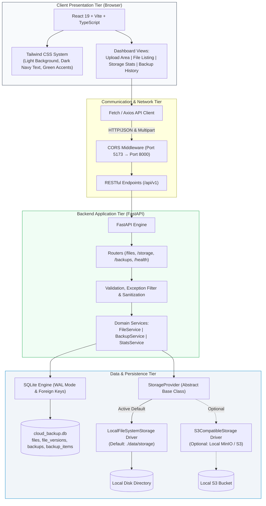

# 🛡️ Cloud Backup System

> **A Self-Hosted, Zero-Cost Cloud Storage & Automated Versioned Backup Platform**  
> Designed as a college capstone project and resume showcase adhering strictly to a **₹0 budget constraint**.

---

## 📌 Project Overview

**Cloud Backup System** is a full-stack, enterprise-grade file storage and backup automation management system. Built to simulate the core capabilities of cloud storage providers (such as AWS S3 or Google Drive), this application eliminates all hosting and cloud subscription fees by operating on local compute and storage while maintaining clean architectural separation.

- **Total Budget**: **₹0 (Zero)** &mdash; No paid cloud accounts, credit cards, or subscription services required.
- **Frontend Architecture**: React 19 + Vite + TypeScript + Tailwind CSS (Light surface, navy text, emerald accents).
- **Backend Architecture**: Python 3 + FastAPI + Uvicorn with asynchronous endpoints and OpenAPI documentation.
- **Persistence Tier**: SQLite 3 with WAL mode for file metadata, immutable versions, audit logs, and backup snapshots.
- **Storage Tier**: Local filesystem backing (default) with an object-oriented `StorageProvider` abstraction layer plus optional S3-compatible object store driver (MinIO Community, LocalStack, SeaweedFS).
- **Testing**: `pytest` for backend API and unit tests (25 passing tests); `vitest` for frontend component verification.
- **DevOps & CI/CD**: Local Jenkins pipeline (`Jenkinsfile`), Docker, and Docker Compose for zero-cost build automation.

---

## 🔍 MinIO Licensing & Zero-Cost Compliance Check

| Topic | Analysis & Compliance Status |
| :--- | :--- |
| **MinIO Community** | Licensed under **GNU AGPLv3**. Free of charge (₹0) to download and run locally as a Docker container for student/internal use. However, AGPLv3 imposes strong network copyleft if modified server code is offered as a network service. |
| **MinIO Commercial** | Proprietary license (MinIO Enterprise / AIStor). Requires paid subscriptions. **Not used.** |
| **Python SDK (`boto3`)** | Uses `boto3` licensed under **Apache License 2.0** (permissive, zero-cost, maintained by AWS). Communicates via standard S3 protocol without any AGPLv3 infection of the backend code. |
| **Permissive Alternatives** | If AGPLv3 is undesirable in commercial contexts, the backend seamlessly connects to **SeaweedFS** (Apache 2.0) or **LocalStack Community** (Apache 2.0) by simply updating `S3_ENDPOINT_URL`. |
| **Default Guarantee** | **All core features operate out of the box with `STORAGE_PROVIDER=local` requiring zero external services.** MinIO is strictly an optional local enhancement. |

---

## 📐 System Architecture

The project is structured as a decoupled monorepo with an abstract storage provider layer:



---

## 🗂️ Monorepo Structure

```text
cloud_backup_system/
├── .env.example              # Master environment configuration template
├── .gitignore                # Multi-language Git ignore rules (preserves Jenkinsfile)
├── Jenkinsfile               # Declarative Jenkins CI/CD pipeline skeleton (₹0 local runners)
├── README.md                 # Primary project documentation
├── docs/                     # System design and specifications
│   ├── api_specification.md  # Implemented REST API contracts
│   ├── architecture.md       # Architecture deep-dive, MinIO check, and ER diagram
│   └── phase_plan.md         # 6-phase milestone development roadmap
├── backend/                  # Python 3 + FastAPI Application
│   ├── .env.example          # Backend environment variables template
│   ├── requirements.txt      # Free and maintained Python dependencies
│   ├── app/
│   │   ├── __init__.py
│   │   ├── main.py           # FastAPI entry point, lifespan, CORS, and exception filter
│   │   ├── core/             # Configuration and environment loaders
│   │   │   ├── __init__.py
│   │   │   └── config.py
│   │   ├── db/               # SQLite database manager & relational schemas
│   │   │   ├── __init__.py
│   │   │   └── database.py
│   │   ├── models/           # Pydantic validation and response schemas
│   │   │   ├── __init__.py
│   │   │   └── schemas.py
│   │   ├── routers/          # API route definitions
│   │   │   ├── __init__.py
│   │   │   ├── health.py     # System health and diagnostics
│   │   │   ├── files.py      # Upload, download, list, versions, restore, delete
│   │   │   ├── storage.py    # Capacity metrics and quota stats
│   │   │   └── backups.py    # Backup snapshot trigger and audit history
│   │   ├── services/         # Domain business logic
│   │   │   ├── __init__.py
│   │   │   ├── file_service.py
│   │   │   ├── backup_service.py
│   │   │   └── stats_service.py
│   │   └── storage/          # Storage abstraction drivers
│   │       ├── __init__.py
│   │       ├── base.py       # StorageProvider Abstract Base Class (ABC)
│   │       ├── local.py      # LocalFileSystemStorage driver (atomic, secure)
│   │       └── s3.py         # S3CompatibleStorage driver (MinIO/S3 via boto3)
│   ├── tests/                # Pytest test suite (25 tests passing)
│   │   ├── __init__.py
│   │   ├── conftest.py       # Isolated SQLite & storage fixtures
│   │   ├── test_health.py
│   │   ├── test_storage_interface.py
│   │   ├── test_storage_local.py
│   │   ├── test_storage_s3.py
│   │   ├── test_file_operations.py
│   │   ├── test_security_and_validation.py
│   │   └── test_backups.py
│   └── data/                 # Ignored local persistence directories
│       ├── .gitkeep
│       └── storage/
│           └── .gitkeep
├── frontend/                 # React 19 + Vite + TypeScript + Tailwind CSS
│   ├── .env.example          # Frontend environment variables
│   ├── index.html            # Semantic HTML entry with Inter font
│   ├── package.json          # Node dependencies and build scripts
│   ├── src/                  # React dashboard UI
│   └── tests/                # Frontend Vitest test suite
└── docker/                   # Docker and Compose configurations (Phase 5)
    └── .gitkeep
```

---

## 🚀 Running the Backend (Windows PowerShell)

### 1. Configure Environment
```powershell
# Navigate to backend directory
cd c:\antigravity_projects\cloud_backup_system\backend

# Create your local .env file from the template
Copy-Item .env.example .env
```

### 2. Run All Automated Tests
```powershell
# Execute the full pytest test suite
python -m pytest tests/ -v
```
*Output: 25 passed, 1 skipped (live MinIO skipped when offline), 0 failed.*

### 3. Start the Backend API Server
```powershell
# Launch development server on port 8000
python -m uvicorn app.main:app --host 127.0.0.1 --port 8000 --reload
```

### 4. Inspect Live API Documentation
Once running, open your web browser to:
- **Interactive Swagger Docs**: [http://127.0.0.1:8000/docs](http://127.0.0.1:8000/docs)
- **ReDoc Documentation**: [http://127.0.0.1:8000/redoc](http://127.0.0.1:8000/redoc)
- **Health Check Endpoint**: [http://127.0.0.1:8000/api/v1/health](http://127.0.0.1:8000/api/v1/health)
- **Storage Metrics Endpoint**: [http://127.0.0.1:8000/api/v1/storage/stats](http://127.0.0.1:8000/api/v1/storage/stats)

---

## 📦 Optional: Running with Local MinIO (S3 Mode)

To test the S3 adapter locally using free MinIO Community:
```powershell
# 1. Run MinIO container locally via Docker (₹0 cost)
docker run -d -p 9000:9000 -p 9001:9001 --name minio_local -e "MINIO_ROOT_USER=minioadmin" -e "MINIO_ROOT_PASSWORD=minioadmin" minio/minio:latest server /data --console-address ":9001"

# 2. Update backend/.env:
# STORAGE_PROVIDER=s3
# S3_ENDPOINT_URL=http://127.0.0.1:9000
# S3_ACCESS_KEY=minioadmin
# S3_SECRET_KEY=minioadmin
# S3_BUCKET_NAME=cloud-backup-system

# 3. Re-run tests (the live MinIO integration test will automatically run and pass):
python -m pytest tests/test_storage_s3.py -v
```

---

## 🔒 Security & Scope Limitations

1. **Path Traversal Protection**: Directory traversal (`../../`) and absolute paths are rejected.
2. **Device Name Filter**: Windows reserved filenames (`CON`, `PRN`, `AUX`, `NUL`, etc.) are blocked.
3. **Immutable History**: Historical object keys cannot be overwritten. Uploading a revised file creates a new unique key and increments the version counter.
4. **Data Isolation**: Internal disk paths are masked in API outputs.
5. **Scope Notice**: Designed as a single-user local demonstration system without multi-user authentication.
