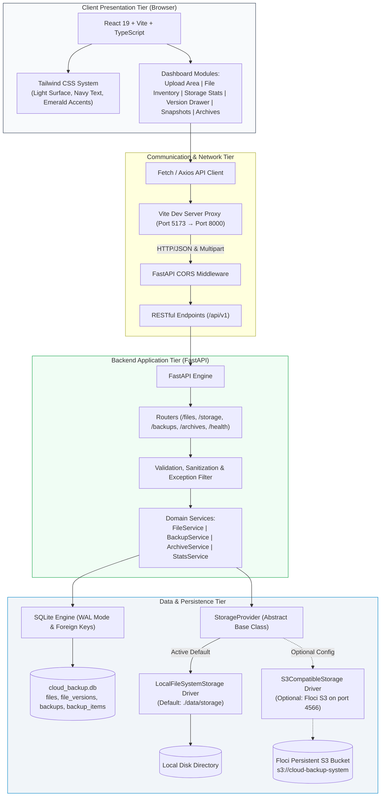

# 🛡️ Cloud Backup System

> **A Self-Hosted, Zero-Cost File Storage & Versioned Backup Automation Platform**
>
> Built with FastAPI, React 19, TypeScript, Tailwind CSS, SQLite 3 (WAL Mode), and an Abstract Storage Provider Layer (Local Filesystem + Floci S3-Compatible Emulator).

---

## 📌 1. Project Title & Description

**Cloud Backup System** is an open-source, self-hosted web application engineered to demonstrate the architectural principles of versioned cloud storage (such as Amazon S3 or Google Drive) on local compute and storage infrastructure under a **strict ₹0 budget constraint**.

The application provides multi-version file storage, atomic version rollbacks, cryptographic SHA-256 integrity verification, point-in-time relational metadata snapshots, and standardized portable backup archives (`.zip` format v1.0.0) with zero external subscription dependencies.

> [!NOTE]
> **Deployment & Demonstration Scope**: This project is designed and evaluated strictly as a **single-user local demonstration system** running on a workstation or developer machine. It is **not** hosted on public cloud infrastructure, does **not** connect to real AWS cloud services, and does not provide multi-tenant authentication.

---

## 🎯 2. Project Overview & Objectives

### Academic & Capstone Context
Designed as a software engineering college capstone project and DevOps portfolio showcase, this platform demonstrates:
- Clean architectural separation between client presentation, API gateway, business domain services, and storage abstractions.
- Immutable file versioning where uploading a modified file with an existing filename automatically increments version history without destroying previous versions.
- Cryptographic integrity guarantees using SHA-256 hashing across all uploads, downloads, snapshots, and archive extractions.
- Reliable, reproducible quality gates via both cloud-native GitHub Actions CI and self-hosted Declarative Jenkins pipelines.

### Zero-Cost Compliance Mandate
- **Total Budget**: **₹0 (Zero)** &mdash; No paid cloud accounts, paid API keys, credit cards, or SaaS subscriptions.
- **Compute & Persistence**: Runs 100% on local machine resources (Python 3.12+, Node.js 20+, SQLite 3 WAL mode).
- **Object Storage Emulation**: Uses **Floci** (`floci/floci:2.3.0`, MIT License, ₹0 cost), an open-source local AWS emulator running on port 4566, configured with synchronous disk persistence via Docker named volumes.

---

## ✨ 3. Features

- **Multi-Version File Lifecycle**:
  - Drag-and-drop or single-click file uploads with pre-upload size validation (<50 MB) and Windows reserved device name filters.
  - Automatic version incrementing (`v1`, `v2`, etc.) with user-supplied change summary notes.
  - Deduplicated, content-addressed, or safely namespaced immutable storage keys.
- **Instantaneous Version Rollback**:
  - Slide-over timeline drawer displaying complete historical version lineage, sizes, and timestamps.
  - On-demand download of current or any historical version.
  - Atomic one-click restore that updates the active version pointer while preserving full historical lineage.
- **Point-in-Time System Snapshots**:
  - Manual creation of immutable system-wide metadata snapshots.
  - Cryptographic manifest verification using deterministic aggregate SHA-256 checksums.
  - Chronological audit log trail tracking total files, sizes, and point-in-time status.
- **Portable Backup Archives (.zip Format v1.0.0)**:
  - Export all active files and historical versions into a self-contained, standard ZIP archive with a root `manifest.json`.
  - Dry-run archive verification validating uncompressed byte counts, zip-bomb safety limits, and SHA-256 hashes without modifying state.
  - Independent restoration into clean target installations with configurable collision strategies (`rename` [default], `skip`, `replace`).
- **Real-Time Storage Monitoring**:
  - Visual quota progress bar (default 50 MB local quota).
  - Tracked files and version counters.
  - Active storage driver badge (`local` vs. `s3`).
- **Resilience & Graceful Degradation**:
  - Live backend heartbeat indicator with automatic reconnect status banner.
  - Fail-fast error propagation ensuring storage unavailability never silently corrupts data.

---

## 🛠️ 4. Technology Stack

| Layer | Technology | Version | Purpose & Licensing |
| :--- | :--- | :--- | :--- |
| **Frontend UI** | React | 19.0.0 | Component hierarchy, state management (MIT) |
| **Build Tool** | Vite | 6.4.5 | Fast ESM bundling and reverse proxy development server (MIT) |
| **Language (Web)** | TypeScript | 5.7.2 | Type-safe interfaces matching backend Pydantic schemas (Apache 2.0) |
| **Styling** | Tailwind CSS | 3.4.17 | Utility-first responsive design tokens (navy, light slate, emerald) |
| **Icons** | Lucide React | 0.475.0 | Accessible UI icons (ISC) |
| **Backend Framework** | FastAPI | 0.141.1 | High-performance asynchronous Python web framework (MIT) |
| **ASGI Server** | Uvicorn | 0.54.0 | Asynchronous HTTP server implementation (BSD-3-Clause) |
| **Data Validation** | Pydantic | 2.13.5 | Strict schema validation and settings management (MIT) |
| **Database** | SQLite 3 | Built-in | Embedded relational persistence with WAL mode and foreign keys (Public Domain) |
| **Storage (Primary)** | Local Filesystem | Standard Library | Zero-dependency atomic file operations with path-traversal guards |
| **Storage (Optional S3)** | Floci / `boto3` | 2.3.0 / 1.43+ | Local open-source S3 emulator (MIT) + Python AWS SDK (Apache 2.0) |
| **Containerization** | Docker Compose | 2.38+ | Multi-container local orchestration with persistent named volumes |
| **Backend Testing** | pytest | 9.1.1 | Unit, integration, E2E smoke, and archive recovery tests (MIT) |
| **Frontend Testing** | Vitest | 3.2.7 | React component testing with JSDOM and Testing Library (MIT) |
| **CI / CD (Cloud-Native)**| GitHub Actions | v4 Actions | Zero-cost automated quality gates on standard GitHub-hosted runners |
| **CI / CD (Self-Hosted)** | Declarative Jenkins | Jenkinsfile | Local cross-platform declarative CI pipeline skeleton |

---

## 📐 5. Architecture Diagram

The system operates as a decoupled monorepo structured into four distinct architectural tiers:



---

## 📸 6. Application Screenshots

The dashboard is designed for desktop and tablet screens with an uncluttered interface, dark navy typography, and emerald accents.

```text
+------------------------------------------------------------------------------------------------------+
|  🛡️ Cloud Backup System       [Self-Hosted]  [Backup & Recovery Active]       ● Backend Connected    |
+------------------------------------------------------------------------------------------------------+
|  +---------------------------+  +---------------------------+  +----------------------------------+  |
|  | STORAGE USAGE             |  | TRACKED FILES             |  | ACTIVE STORAGE BACKEND           |  |
|  | 2.45 MB / 50.00 MB  (5%)  |  | 3 Files (5 Versions)      |  | Local Disk (./data/storage)      |  |
|  | [|||||                  ] |  | Last Backup: 2 mins ago   |  | Quota Status: Healthy            |  |
|  +---------------------------+  +---------------------------+  +----------------------------------+  |
|                                                                                                      |
|  +------------------------------------------------------------------------------------------------+  |
|  |  UPLOAD FILE (DRAG & DROP OR BROWSE)                                                           |  |
|  |  [ Drop file here (max 50 MB) ]  Change Summary: [ Updated architecture benchmarks           ]  |  |
|  +------------------------------------------------------------------------------------------------+  |
|                                                                                                      |
|  [ File Inventory ]   [ Backup Snapshots ]   [ Portable Archives (.zip) ]                            |
|  +------------------------------------------------------------------------------------------------+  |
|  | Filename            Current Version   Size       SHA-256 Fingerprint     Actions               |  |
|  |------------------------------------------------------------------------------------------------|  |
|  | project_spec.md     v2 (Latest)       14.2 KB    35a0e0f0b4e09ca7...     [Download] [Versions] |  |
|  | architecture.pdf    v1 (Initial)      2.41 MB    f634e9a4aa725537...     [Download] [Versions] |  |
|  +------------------------------------------------------------------------------------------------+  |
+------------------------------------------------------------------------------------------------------+
```

*(To add live graphical screenshots to your GitHub fork, capture PNG images from `http://localhost:5173` and place them under `docs/screenshots/` referencing ``).*

---

## 🗂️ 7. Project Directory Structure

```text
cloud_backup_system/
├── .github/
│   └── workflows/
│       └── ci.yml                 # Cloud-native zero-cost GitHub Actions workflow
├── .env.example                   # Master environment configuration template
├── .gitignore                     # Multi-language Git ignore rules (targeted archive patterns)
├── Jenkinsfile                    # Cross-platform Declarative Jenkins CI/CD pipeline
├── README.md                      # Comprehensive project documentation
├── docker-compose.yml             # Docker Compose orchestration (Local + Floci S3 profile)
├── docs/                          # Architecture, API specs, CI/CD guides, and phase plans
│   ├── api_specification.md       # Implemented REST API contracts & JSON schemas
│   ├── architecture.md            # Deep-dive architecture, ER diagram, and Floci analysis
│   ├── github-actions-ci.md       # GitHub Actions CI operational & billing guide
│   ├── jenkins-ci-cd.md           # Self-hosted Jenkins CI architecture & troubleshooting
│   └── phase_plan.md              # Phased milestone roadmap (Phases 1–13)
├── scripts/                       # Automated PowerShell and Python verification scripts
│   ├── smoke-test.ps1             # 10-step end-to-end API smoke test workflow
│   ├── start-local.ps1            # Local development launcher for Windows
│   └── verify-archive-recovery.py # Phase 8 isolated disaster recovery audit script
├── backend/                       # Python 3 + FastAPI Application
│   ├── .env.example               # Backend environment variables template
│   ├── requirements.txt           # Pinned Python open-source dependencies
│   ├── app/
│   │   ├── main.py                # FastAPI entry point, lifespan, CORS, and exception filter
│   │   ├── core/config.py         # Pydantic Settings configuration loader
│   │   ├── db/database.py         # SQLite connection manager, schemas, WAL mode
│   │   ├── models/schemas.py      # Pydantic request & response schemas
│   │   ├── routers/               # Versioned REST routers (/health, /files, /storage, etc.)
│   │   ├── services/              # Domain logic (FileService, BackupService, ArchiveService)
│   │   └── storage/               # Storage abstraction layer (LocalFileSystem & Floci S3)
│   ├── data/                      # Local persistence directory (cloud_backup.db & files/)
│   └── tests/                     # 47 automated Pytest unit and integration tests
├── frontend/                      # React 19 + Vite + TypeScript + Tailwind CSS
│   ├── .env.example               # Frontend environment variables template
│   ├── package.json               # Node dependencies and build scripts
│   ├── vite.config.ts             # Vite configuration with /api reverse proxy
│   ├── src/                       # React components, API client, and application root
│   └── tests/                     # 19 Vitest component tests across 5 test suites
└── docker/                        # Production Dockerfiles and container configurations
    ├── Dockerfile.backend         # Multi-stage Python 3.12 slim container
    ├── Dockerfile.frontend        # Multi-stage Node 20 alpine + Nginx reverse proxy
    └── nginx.conf                 # Nginx reverse proxy routing /api/ to backend
```

---

## 📋 8. Prerequisites

Ensure the following runtimes and tools are installed on your Windows machine:

| Tool | Recommended Version | Verification Command | Required For |
| :--- | :--- | :--- | :--- |
| **Python** | 3.10 to 3.14 (3.12+ recommended) | `python --version` | FastAPI Backend & Pytest |
| **Node.js** | 20 LTS or higher | `node --version` | React Dashboard UI |
| **npm** | 10 or 11 | `npm.cmd --version` | Frontend Dependencies & Vitest |
| **Git** | 2.40+ | `git --version` | Version Control |
| **Docker Desktop** | 24+ (Optional) | `docker --version` | Floci Local S3 Emulator Mode |

---

## 💻 9. Windows Installation & Setup Instructions

Open a standard Windows PowerShell terminal:

```powershell
# 1. Navigate to your projects directory and open the workspace
cd C:\antigravity_projects\cloud_backup_system

# 2. Configure environment files from templates
Copy-Item .env.example .env
Copy-Item backend\.env.example backend\.env
Copy-Item frontend\.env.example frontend\.env

# 3. Install Backend Python Dependencies
cd backend
python -m pip install --upgrade pip
pip install -r requirements.txt
cd ..

# 4. Install Frontend Node Dependencies
cd frontend
npm.cmd ci
cd ..
```

---

## 🚀 10. Backend Startup Instructions

In your first PowerShell terminal, launch the FastAPI server:

```powershell
cd C:\antigravity_projects\cloud_backup_system\backend

# Launch ASGI server on port 8000
python -m uvicorn app.main:app --host 127.0.0.1 --port 8000 --reload
```

- **API Base URL**: `http://127.0.0.1:8000`
- **Interactive Swagger Documentation**: [http://127.0.0.1:8000/docs](http://127.0.0.1:8000/docs)
- **ReDoc Documentation**: [http://127.0.0.1:8000/redoc](http://127.0.0.1:8000/redoc)
- **Health Check Endpoint**: [http://127.0.0.1:8000/api/v1/health](http://127.0.0.1:8000/api/v1/health)

---

## 🖥️ 11. Frontend Startup Instructions

In a second PowerShell terminal, start the Vite development server:

```powershell
cd C:\antigravity_projects\cloud_backup_system\frontend

# Launch Vite development server on port 5173
npm.cmd run dev
```

- **Web Dashboard**: [http://localhost:5173](http://localhost:5173)
- The Vite development server automatically reverse-proxies all `/api/*` network requests directly to `http://127.0.0.1:8000` with zero Cross-Origin Resource Sharing (CORS) friction.

---

## 🐳 12. Docker & Floci S3 Emulator Setup

### What is Floci?
**Floci** (`floci/floci:2.3.0`) is a free, MIT-licensed local AWS emulator running locally on port **4566**. It simulates Amazon S3 APIs, allowing the backend to be evaluated against the S3 object store protocol without real AWS credentials, cloud accounts, or billing risks.

> [!WARNING]
> **Local Emulator Disclaimer**: Floci is an emulator running locally on your workstation. It does **not** connect to real Amazon Web Services and does **not** provide off-site disaster recovery or geographical redundancy. All core application features function out of the box using default local filesystem storage without Docker.

### Running Floci via Docker Compose

```powershell
# 1. Start Floci container with dedicated persistent named volume
cd C:\antigravity_projects\cloud_backup_system
docker compose --profile s3 up -d floci

# 2. Verify Floci health endpoint
Invoke-RestMethod -Uri "http://127.0.0.1:4566/_floci/health"
```

### Running Backend in Floci Mode
In your backend PowerShell terminal, set the storage provider to `s3`:

```powershell
cd C:\antigravity_projects\cloud_backup_system\backend
$env:STORAGE_PROVIDER="s3"
$env:S3_ENDPOINT_URL="http://127.0.0.1:4566"
$env:S3_ACCESS_KEY="test"
$env:S3_SECRET_KEY="test"
$env:S3_BUCKET_NAME="cloud-backup-system"
python -m uvicorn app.main:app --host 127.0.0.1 --port 8000 --reload
```

### Safely Stopping Floci (Preserves Data)
```powershell
# Stop container without destroying persistent volume
docker compose stop floci

# Do NOT use 'docker compose down -v' unless you explicitly intend to wipe stored data!
```

---

## 📡 13. REST API Documentation & Contracts

All endpoints are versioned under `/api/v1`. Interactive exploration is available via Swagger at [http://127.0.0.1:8000/docs](http://127.0.0.1:8000/docs).

| HTTP Method | Endpoint | Description | Status Code |
| :--- | :--- | :--- | :---: |
| `GET` | `/` | Root API welcome message and route sitemap | `200 OK` |
| `GET` | `/api/v1/health` | System liveness, database status, and active storage engine | `200 OK` |
| `POST` | `/api/v1/files/upload` | Upload file (`multipart/form-data`) & increment version | `201 Created` |
| `GET` | `/api/v1/files` | List active files with pagination and search filter | `200 OK` |
| `GET` | `/api/v1/files/{file_id}` | Retrieve metadata for a specific file | `200 OK` |
| `GET` | `/api/v1/files/{file_id}/download` | Download current or historical version (`?version_id=...`) | `200 OK` |
| `GET` | `/api/v1/files/{file_id}/versions` | Retrieve complete version history lineage | `200 OK` |
| `POST` | `/api/v1/files/{file_id}/restore/{version_id}` | Atomically restore active pointer to a historical version | `200 OK` |
| `DELETE`| `/api/v1/files/{file_id}` | Soft-delete file and exclude from catalog listings | `200 OK` |
| `GET` | `/api/v1/storage/stats` | Storage metrics, quota usage, and masked directory path | `200 OK` |
| `POST` | `/api/v1/backups/trigger` | Create immutable point-in-time relational metadata snapshot | `201 Created` |
| `GET` | `/api/v1/backups/history` | Chronological audit log of all generated snapshots | `200 OK` |
| `GET/POST` | `/api/v1/archives/export` | Export self-contained portable backup archive (`.zip`) | `200 OK` |
| `POST` | `/api/v1/archives/verify` | Dry-run integrity, zip-bomb, and SHA-256 verification | `200 OK` |
| `POST` | `/api/v1/archives/restore` | Restore files and versions from archive (`rename`/`skip`/`replace`) | `200 OK` |

---

## 🧪 14. Automated Testing Commands & Verified Results

The platform enforces 100% test passing gates across backend, frontend, and isolated disaster recovery workflows.

### 1. Backend Pytest Suite
```powershell
cd C:\antigravity_projects\cloud_backup_system
python -m pytest backend/tests -v
```
- **Verified Result (Floci Online)**: **47 passed, 0 failed (100% passing)** in ~18 seconds.
- **Verified Result (Floci Offline)**: **45 passed, 2 skipped, 0 failed** in ~19 seconds. (The two live Floci tests skip gracefully when the local emulator is offline).

### 2. Frontend Vitest Suite
```powershell
cd C:\antigravity_projects\cloud_backup_system\frontend
npm.cmd test
```
- **Verified Result**: **19 passed across 5 test suites (100% passing)** in ~12 seconds.

### 3. Frontend Production Build Check
```powershell
cd C:\antigravity_projects\cloud_backup_system\frontend
npm.cmd run build
```
- **Verified Result**: Zero TypeScript errors. Compiles production assets to `dist/index.html` in ~4.4 seconds.

### 4. Native PowerShell E2E Smoke Test
With the backend running on `http://127.0.0.1:8000`:
```powershell
cd C:\antigravity_projects\cloud_backup_system
powershell.exe -ExecutionPolicy Bypass -File scripts\smoke-test.ps1
```
- **Verified Result**: **10/10 lifecycle operations PASSED** in ~0.5 seconds using temporary UUID-tagged test files.

### 5. Genuine Isolated Disaster Recovery Audit
```powershell
cd C:\antigravity_projects\cloud_backup_system
python scripts/verify-archive-recovery.py
```
- **Verified Result**: **All 8 disaster-recovery audit steps PASSED**. Proves that an exported archive restores into a completely fresh, air-gapped target environment with byte-for-byte fidelity and zero catalog pollution on corrupt archives.

---

## 💾 15. Version Management & Backup Recovery Explanation

To maintain transparency during technical review, the system clearly differentiates between **Metadata Snapshots** and **Portable Backup Archives**:

| Dimension | Point-in-Time Metadata Snapshots (Phase 2) | Portable Backup Archives (Phase 7) |
| :--- | :--- | :--- |
| **Storage Medium** | SQLite `backups` & `backup_items` relational tables | Standard `.zip` binary archive containing `manifest.json` |
| **Contents** | References (`file_id`, `version_id`), sizes, SHA-256 hashes, aggregate checksum | Full binary payload streams under `blobs/` for all versions + root `manifest.json` |
| **Payload Duplication** | Zero duplication (lightweight audit pointer) | Full encapsulation (self-contained disaster recovery) |
| **Independence** | Dependent on existing backend storage and database | **100% Independent** (restores into empty installations) |
| **Primary Use Case** | State auditing, fast version history tracking | Cold storage, hardware migration, disaster recovery |

### Portable Archive Specification (v1.0.0)
```text
cloud_backup_archive_20261110_180000.zip
├── manifest.json                  # Root cryptographic manifest (v1.0.0)
└── blobs/
    ├── {version_id_1}_report.pdf  # Raw payload bytes for File 1, Version 1
    ├── {version_id_2}_report.pdf  # Raw payload bytes for File 1, Version 2
    └── {version_id_3}_config.json # Raw payload bytes for File 2, Version 1
```

- **Conflict Strategies**: When restoring into an environment with existing filenames:
  - `rename` *(Default)*: Safely appends `_imported_{short_uuid}` to colliding filenames, preserving existing data.
  - `skip`: Skips colliding files and imports only new assets.
  - `replace`: Atomically purges colliding existing files and historical versions, replacing them with archive contents.
- **Fail-Safe Integrity**: If any required binary blob is missing during export, the service raises `HTTP 409 Conflict`. **The system never exports a truncated archive while claiming success.**

---

## 🔄 16. GitHub Actions & Jenkins CI/CD Pipelines

### 1. Cloud-Native GitHub Actions CI ([.github/workflows/ci.yml](.github/workflows/ci.yml))
The primary, turnkey automated quality assurance gate:
- **Triggers**: Pushes and Pull Requests to `main` (with `paths-ignore` for markdown documentation), plus manual `workflow_dispatch`.
- **Strict ₹0 Budget Safeguards**:
  - Uses standard GitHub-hosted `ubuntu-latest` Linux runners.
  - Least-privilege permissions: `permissions: contents: read`.
  - Fail-fast timeouts: `timeout-minutes: 10` on all jobs.
  - Concurrency management: automatically cancels stale runs when new commits are pushed.
  - Zero artifact storage overhead: compiles bundles without consuming artifact storage limits.
- **Jobs**:
  1. `backend`: Python 3.12, pip cache, runs all 47 pytest tests.
  2. `frontend`: Node.js 20 LTS, npm cache, `npm ci`, 19 Vitest tests, TypeScript compilation, and Vite production build.
  3. `docker-validation`: Docker Compose syntax validation and local container build checks.
  4. `floci-integration`: Opt-in manual trigger to spin up Floci and run live S3 integration tests.

### 2. Self-Hosted Declarative Jenkins Pipeline ([Jenkinsfile](Jenkinsfile))
Maintained as an alternative for local, air-gapped, or self-hosted CI environments:
- 11 declarative pipeline stages with cross-platform compatibility (`bat` on Windows, `sh` on Linux).
- Standard JUnit XML reporting for both Pytest (`backend-junit.xml`) and Vitest (`frontend-junit.xml`).
- Safe cleanup using `docker compose stop floci` avoiding destructive volume wipes.

---

## 🔒 17. Security Practices & Defenses

1. **Path Traversal Defenses**: Rejects `..`, `/`, `\`, and Windows drive letters (`C:`) in filenames, object keys, and archive entry paths.
2. **Windows Reserved Device Name Filter**: Blocks uploads and archive imports matching `CON`, `PRN`, `AUX`, `NUL`, `COM1-9`, and `LPT1-9`.
3. **Decompression Bomb Protection**: Enforces strict archive safety thresholds:
   - Max archive upload size: **100 MB**
   - Max total uncompressed payload: **250 MB**
   - Max entries: **1,000 files**
   - Max compression ratio: **100:1**
4. **Zero-Trust Archive Identifiers**: Archive UUIDs are never trusted during restore; fresh system UUIDs and storage keys are generated upon import.
5. **Atomic Writing**: Local filesystem writes use temporary PID-tagged files atomically renamed upon completion to prevent partially written blobs.
6. **Path Masking**: Internal operating system paths are masked in API outputs to prevent filesystem enumeration.

---

## ⚠️ 18. Known Limitations

1. **Single-User Local Demonstration**: Designed as an academic capstone showcase without multi-tenant authentication, user sessions, or row-level access control.
2. **Local Storage Reality Check**: Local disk storage and local Floci emulator containers reside on the same physical host machine. They do **not** provide off-site disaster recovery or geographical redundancy unless backup archives are replicated to secondary physical media or remote cold storage.
3. **Database Concurrency**: While SQLite WAL mode supports multi-reader concurrency, write operations are serialized through a single writer lock.
4. **Windows Named Pipe Boundary**: In sandboxed automation environments running at Low Mandatory Level, connecting to Docker Desktop's named pipe requires standard user privileges (`docker-users` group membership).

---

## 🔮 19. Future Improvements

- **Multi-Tenant User Authentication**: Implementation of Argon2id password hashing, JWT bearer tokens, and user-isolated file ownership.
- **Scheduled Automated Backups**: Background cron scheduler to trigger point-in-time snapshots and archive exports automatically.
- **Webhook Alerts**: Outbound webhook notifications on backup success or storage quota warnings.
- **Chunked Resumable Uploads**: Support for chunked multipart uploads for large files (>50 MB).

---

## 📄 20. License & Acknowledgements

### Project Evaluation Notice
This project was designed, developed, and tested as an academic capstone project and DevOps portfolio demonstration.
- **License Status**: No open-source license is provided for this repository. All rights remain with their respective copyright holders. Intended for academic evaluation and portfolio demonstration.

### Open-Source Acknowledgements
Special thanks to the open-source projects and communities powering this platform:
- **FastAPI** & **Starlette** (Sebastián Ramírez)
- **React** (Meta Platforms, Inc.)
- **Vite** (Evan You & Vite Contributors)
- **Tailwind CSS** (Tailwind Labs)
- **SQLite** (D. Richard Hipp & SQLite Team)
- **Floci** (Floci Open Source Project & Contributors)
- **boto3** (Amazon Web Services)
- **pytest** & **Vitest** testing communities
