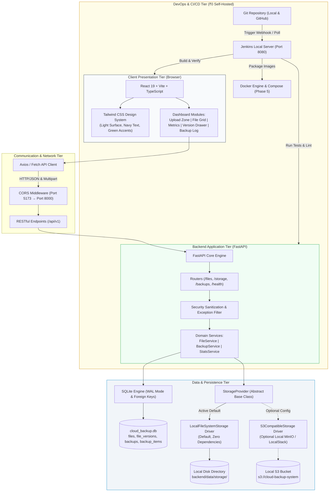
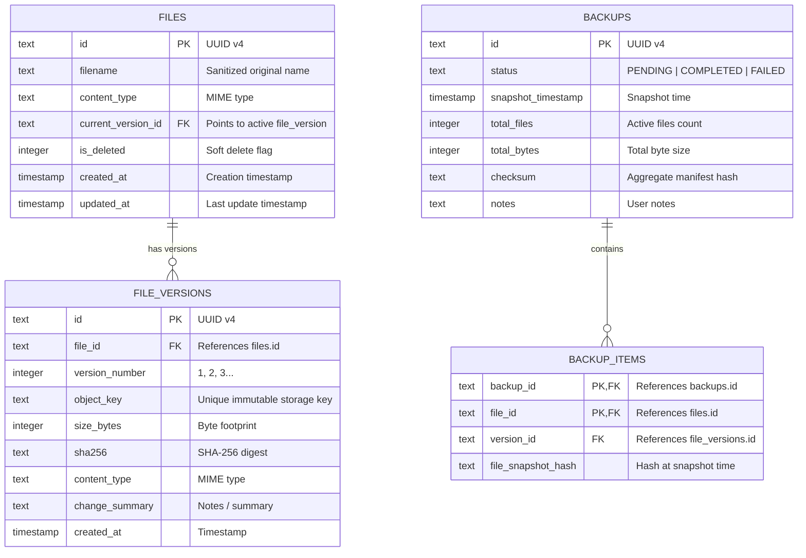

# System Architecture & Technical Design

## 1. Executive Summary & Objective

**Cloud Backup System** is an enterprise-grade, self-hosted file backup and storage management application built under strict **₹0 budget constraints** for academic evaluation, portfolio presentation, and resume building.

The system empowers users to:
- Upload and inspect files through a modern, responsive web dashboard.
- Store files on the local filesystem with an abstract `StorageProvider` interface that optionally connects to local S3-compatible object storage (e.g. MinIO).
- Retain complete immutable version histories: uploading a file with an existing filename automatically increments versioning without overwriting previous versions.
- Download current or any historical versions on demand with SHA-256 integrity verification.
- Restore historical versions with atomic pointer updates while preserving historical content.
- Monitor real-time local storage metrics, quota consumption, and file distribution.
- Generate point-in-time backup snapshots with cryptographic manifest checksums.

---

## 2. Zero-Budget Philosophy & MinIO Licensing Analysis

Every component is intentionally selected to require **no credit card, no cloud provider account, no subscription, and no paid third-party API**:

| Subsystem | Selection | License | Justification |
| :--- | :--- | :--- | :--- |
| **Frontend** | React 19 + Vite + TypeScript + Tailwind CSS | MIT | Fast compilation, modern UX, open source, zero licensing fees. |
| **Backend** | Python 3.10+ + FastAPI + Uvicorn | MIT / BSD | High-throughput asynchronous REST API, auto-generated OpenAPI docs. |
| **Database** | SQLite 3 with WAL Mode | Public Domain | Serverless, zero-maintenance, embedded relational engine. |
| **Storage (Primary)** | Local Host Filesystem | N/A | Zero storage egress or bucket cost; default out-of-the-box mode. |
| **Storage (Optional S3)** | S3-Compatible Driver (boto3) | Apache 2.0 | Connects to local MinIO, LocalStack, or SeaweedFS without vendor lock-in. |
| **Testing** | pytest + Vitest | MIT | Industry-standard open-source testing frameworks. |

### 2.1 MinIO Licensing & Zero-Cost Verification
- **MinIO Editions**:
  - *MinIO Enterprise / AIStor*: Commercial, proprietary licensing, requires paid subscription. **Not used.**
  - *MinIO Community Server*: Free to download and run self-hosted locally under **GNU AGPLv3**. For academic, personal, and internal student projects, it involves ₹0 financial cost. However, AGPLv3 contains strong network copyleft clauses (Section 13) requiring modified server code provided over a network to be open-sourced under AGPLv3.
- **Client Selection (`boto3`)**:
  - We use the standard AWS SDK for Python (`boto3`), licensed under the permissive **Apache License 2.0**. This avoids AGPLv3 dependency infection in the backend application code while communicating with any S3-compatible service over standard HTTP S3 protocols.
- **Maintained Genuinely Free / Open-Source Alternatives**:
  - If AGPLv3 copyleft is undesirable in commercial environments, developers can swap MinIO for:
    1. **SeaweedFS** (Apache 2.0 License, fully open-source, maintained, native S3 API, zero-cost).
    2. **LocalStack Community** (Apache 2.0 License for core emulation, zero-cost).
- **Core Guarantee**:
  - **The system does NOT require MinIO or any external service to function.** `LocalFileSystemStorage` is the default driver. All core features (uploads, downloads, versioning, restore, backups) operate 100% locally on disk at ₹0 cost.

---

## 3. High-Level Architecture Diagram



---

## 4. Relational Data Model (SQLite)

The database schema models logical files separately from immutable file versions, guaranteeing that historical data cannot be overwritten:



---

## 5. Storage Abstraction Architecture

The core of the storage layer is the `StorageProvider` abstract base class:

```python
class StorageProvider(ABC):
    @abstractmethod
    def save_file(self, object_key: str, content: BinaryIO, metadata: Optional[Dict[str, str]] = None) -> StorageItemInfo: ...
    @abstractmethod
    def get_file(self, object_key: str) -> BinaryIO: ...
    @abstractmethod
    def delete_file(self, object_key: str) -> bool: ...
    @abstractmethod
    def file_exists(self, object_key: str) -> bool: ...
    @abstractmethod
    def get_storage_stats(self) -> StorageStatsInfo: ...
```

### 5.1 LocalFileSystemStorage Driver
- **Base Directory**: Defaults to `./data/storage`.
- **Path Traversal Protection**: Rejects keys starting with `/` or `\\`, strips null bytes, and verifies that `resolved_path.relative_to(base_dir)` succeeds.
- **Atomic Writes**: Writes to a temporary `.tmp_{pid}` file and performs an atomic replace, preventing corrupted partial files on server interruption.
- **SHA-256 Checksums**: Computed streaming in 64 KB chunks during upload.

### 5.2 S3CompatibleStorage Driver
- **Connection**: Connects via `boto3` with configured endpoint (`S3_ENDPOINT_URL`), bucket name, and access credentials.
- **Compatibility**: Supports self-hosted MinIO Community, LocalStack, and SeaweedFS.
- **Security**: Never exposes credentials to API consumers; credentials reside strictly in server environment variables.

---

## 6. Security & Safety Model

1. **Path Traversal Shielding**: File storage keys are server-controlled (`files/{file_id}/{version_id}_{safe_filename}`). Client-provided directory paths are strictly stripped.
2. **Windows Device Name Blacklist**: Filenames matching reserved Windows devices (`CON`, `PRN`, `AUX`, `NUL`, `COM1-9`, `LPT1-9`) are rejected with `400 Bad Request`.
3. **Upload Size Limits**: Enforces `MAX_UPLOAD_SIZE_MB` (default 50 MB) streaming check, returning `413 Payload Too Large` without buffering excessive bytes into memory.
4. **Information Leakage Prevention**: Custom exception handlers catch unexpected runtime errors and return generic error messages, preventing stack traces and internal host paths (`C:\...`) from leaking.
5. **Single-User Scope Notice**: Designed as a single-user local demonstration system without multi-tenant authentication.
