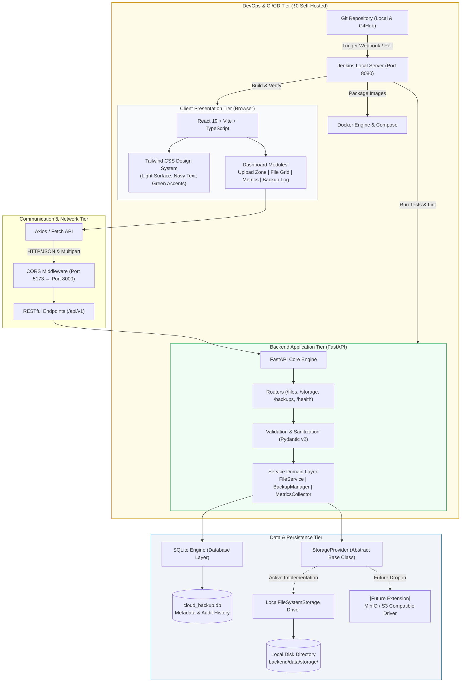

# System Architecture & Technical Design

## 1. Executive Summary & Objective

**Cloud Backup System** is an enterprise-grade, self-hosted file backup and storage management application built under strict **₹0 budget constraints** for academic evaluation, portfolio presentation, and resume building.

The system empowers users to:
- Upload and inspect files through a modern, responsive web dashboard.
- Monitor real-time local storage metrics, quota consumption, and file distribution.
- Track automated backup snapshots and historical restore points.
- Benefit from a modular storage provider abstraction layer that runs seamlessly on the local filesystem today while remaining 100% pluggable for object storage (e.g., MinIO or S3) in the future.

---

## 2. Zero-Budget Philosophy (₹0 Spent)

Every component is intentionally selected to require **no credit card, no cloud provider account, no subscription, and no paid third-party API**:

| Subsystem | Selection | Justification |
| :--- | :--- | :--- |
| **Frontend** | React 19 + Vite + TypeScript + Tailwind CSS | Fast compilation, modern UX, open source, zero licensing fees. |
| **Backend** | Python 3 + FastAPI + Uvicorn | High-throughput asynchronous REST API, auto-generated OpenAPI docs. |
| **Database** | SQLite 3 | Serverless, zero-maintenance, zero-cost embedded relational engine. |
| **File Storage** | Local Host Filesystem | Zero storage egress or bucket cost; abstracted behind a generic interface. |
| **Testing** | pytest + Vitest | Industry-standard open-source testing frameworks. |
| **CI / CD** | Local Jenkins Pipeline | Automated build and test pipeline running locally on port 8080. |
| **Containerization** | Docker & Docker Compose | Multi-container reproducible runtime without cloud registry fees. |

---

## 3. High-Level Architecture Diagram

The system follows a decoupled, three-tier architecture with an abstract storage provider layer:



---

## 4. Key Component Breakdown

### 4.1 Frontend Tier (`frontend/`)
- **Technology**: React 19, Vite, TypeScript, Tailwind CSS, Lucide React icons.
- **Visual Design Identity**:
  - **Background**: Crisp clean light surfaces (`#f8fafc`, `#ffffff`).
  - **Typography & Structural Elements**: Deep navy blue (`#0f172a`, `#1e293b`).
  - **Accent & Actions**: Emerald & mint greens (`#10b981`, `#059669`, `#34d399`) representing health, backup integrity, and secure status.
- **Key Modules**:
  1. *Quick Stats Banner*: Total storage utilized, file count, and last successful backup timestamp.
  2. *Interactive Drag & Drop Upload Zone*: Real-time file validation (extension, size, hashing).
  3. *Files Inventory Table*: Sortable, searchable listing with metadata (name, size, mime type, hash, creation date).
  4. *Backup History & Trigger*: Instant manual snapshot trigger with chronological audit table.

### 4.2 Backend Tier (`backend/`)
- **Technology**: Python 3.10+, FastAPI, Uvicorn, Pydantic v2.
- **Responsibilities**:
  - Request validation, multipart streaming for memory-efficient uploads.
  - Computing cryptographic hashes (SHA-256) for deduplication and file verification.
  - Exposing structured JSON responses adhering to OpenAPI / Swagger standards (`/docs`).
  - Graceful error handling and standardized response envelopes.

### 4.3 Database & Metadata Tier (`backend/app/db/`)
- **Engine**: SQLite 3 with WAL (Write-Ahead Logging) enabled for concurrency.
- **Primary Entities**:
  - `files`: File ID (UUID), original filename, stored filename, file size, SHA-256 hash, mime type, creation timestamp, status.
  - `backups`: Backup ID, snapshot timestamp, total files count, total size bytes, checksum, status (COMPLETED, FAILED).
  - `backup_items`: Join table linking files to specific backup snapshots.

### 4.4 Storage Abstraction Layer (`backend/app/storage/`)
- A strict interface (`StorageProvider`) isolates application logic from physical disk operations:
  ```python
  class StorageProvider(ABC):
      async def save_file(self, file_id: str, content: BinaryIO) -> StoredFileInfo: ...
      async def get_file(self, file_id: str) -> BinaryIO: ...
      async def delete_file(self, file_id: str) -> bool: ...
      async def get_stats(self) -> StorageStats: ...
  ```
- Current Implementation: `LocalFileSystemStorage` writes to `backend/data/storage/`.
- Future compatibility: Changing storage backends requires zero changes to routers or business logic.

---

## 5. Security & Reliability Guidelines
- **Path Traversal Protection**: Uploaded files are renamed using secure UUID v4 tokens on disk; original filenames are stored in the SQLite database only.
- **MIME & Extension Sanitization**: Validation occurs before committing payloads to disk.
- **CORS Safeguards**: Strict origin headers allow only trusted local dev ports (`http://localhost:5173`, `http://127.0.0.1:5173`).
- **Secret Isolation**: Configuration is decoupled via `.env` with `.env.example` templates committed without secrets.
