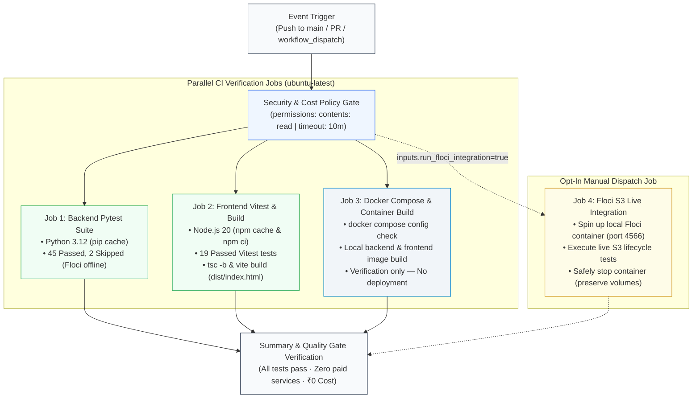

# 🚀 GitHub Actions CI Pipeline Documentation (Strict ₹0 Cost)

> **Cloud Backup System — Automated Continuous Integration & Quality Gates**  
> Designed for reproducible zero-cost verification adhering strictly to GitHub's included free allowance and open-source tooling.

---

## 1. Overview & Architectural Design

The Cloud Backup System utilizes an automated **GitHub Actions CI Workflow** ([.github/workflows/ci.yml](file:///c:/antigravity_projects/cloud_backup_system/.github/workflows/ci.yml)) as the primary, cloud-native quality assurance gate for the repository. It serves as an alternative to the self-hosted Jenkins configuration ([Jenkinsfile](file:///c:/antigravity_projects/cloud_backup_system/Jenkinsfile)), eliminating the need to maintain an active local Jenkins daemon while preserving a **strict ₹0 budget**.

---

## 2. Strict ₹0 Cost Policy & Free-Tier Plan Limits

### Permitted Resources
- Standard GitHub-hosted `ubuntu-latest` runners included within GitHub's monthly plan allowance.
- Free, open-source runtimes and tools: Python 3.12, pytest, Node.js 20 LTS, npm, Vite, Docker Compose, and Floci emulator (`floci/floci:2.3.0`).
- Official, GitHub-maintained Actions: `actions/checkout@v4`, `actions/setup-python@v5`, and `actions/setup-node@v4`.
- Standard built-in dependency caching via official setup actions (`cache: 'pip'` and `cache: 'npm'`).

### Prohibited Resources
- Paid plans, trials requiring credit cards, paid marketplace actions, and self-hosted/paid runners.
- External cloud infrastructure (AWS, Azure, Google Cloud). Real AWS credentials or services are strictly forbidden.
- Container registry pushes (Docker Hub, GitHub Container Registry, AWS ECR).
- Production deployment or cloud hosting actions.
- Any setting that could trigger overage charges.

### Public vs. Private Repository Billing Limits
- **Public Repositories**: GitHub Actions is **100% free with unlimited minutes** on standard GitHub-hosted Linux runners.
- **Private Repositories**: GitHub provides plan-specific included monthly minutes:
  - **GitHub Free**: **2,000 minutes/month** of Linux runners (`ubuntu-latest` multiplier = 1x).
  - **GitHub Pro**: **3,000 minutes/month**.
  - **GitHub Team**: **3,000 minutes/month**.
- **Execution Cost Calculation**: A complete run of all parallel jobs takes ~1.5 minutes total runner time. Under a 2,000-minute free allowance, this permits **over 1,000 complete workflow runs per month at ₹0 cost**.

### Cost Safeguards Implemented in Workflow
1. **Strict Job Timeouts**: `timeout-minutes: 10` on all jobs ensures that any stuck worker process terminates automatically before consuming minutes.
2. **Concurrency Control**: `concurrency: { group: ..., cancel-in-progress: true }` immediately cancels stale running builds when a new commit is pushed to the same pull request or branch.
3. **No Artifact Uploads**: By default, build artifacts (such as `dist/` or test reports) are not uploaded to GitHub's storage, preserving your included 500 MB storage allowance.
4. **Least-Privilege Security**: `permissions: contents: read` prevents the workflow from mutating repository tags, releases, or settings.
5. **Spending Limit Safeguard**: GitHub accounts have a default **$0 Spending Limit**. This guarantees that if included minutes are ever exhausted, workflows pause rather than incurring a bill.

---

## 3. Workflow Triggers & Execution Options

The workflow is configured with three distinct triggers:

| Trigger | Condition | Purpose |
| :--- | :--- | :--- |
| `push` | Commits pushed to `main` | Automatic regression testing on default branch merges. |
| `pull_request` | PRs opened or updated against `main` | Automated quality gate validation before code review. |
| `workflow_dispatch` | Manual execution from GitHub Actions UI | On-demand testing with optional parameterized flags. |

### Manual Dispatch Parameters (`workflow_dispatch`)
When triggering manually from the GitHub UI, two optional toggles are available:
- **`build_docker`** *(default: `true`)*: Builds local Docker images (`cloud-backup-backend:ci` and `cloud-backup-frontend:ci`) to verify Dockerfiles without deployment.
- **`run_floci_integration`** *(default: `false`)*: Launches the local Floci container on the runner and executes live S3 integration tests.

---

## 4. Pipeline Stages & Verification Breakdown

### Job 1: Backend Verification (`backend`)
- **Environment**: Python 3.12 with pip dependency caching.
- **Dependencies**: Installed from [backend/requirements.txt](file:///c:/antigravity_projects/cloud_backup_system/backend/requirements.txt).
- **Execution**: `python -m pytest backend/tests/ -v -ra`
- **Quality Gate**:
  - **45 unit, security, file operation, and backup snapshot tests MUST pass**.
  - **2 Floci live integration tests are legitimately skipped** when the Floci container is not running (`test_floci_integration.py` and `test_storage_s3.py`). Pytest's `-ra` flag explicitly reports these skips and reasons.
  - **0 failed tests**.

### Job 2: Frontend Verification (`frontend`)
- **Environment**: Node.js 20 LTS with npm dependency caching.
- **Dependencies**: Installed via strict, reproducible `npm ci` from [frontend/package-lock.json](file:///c:/antigravity_projects/cloud_backup_system/frontend/package-lock.json).
- **Component Tests**: `npm test` runs Vitest across 5 test suites (19 unit/component tests passing).
- **Production Compilation**: `npm run build` runs TypeScript verification (`tsc -b`) and Vite production bundling (`vite build`).
- **Integrity Assertion**: `test -f dist/index.html` validates that production distribution assets were successfully generated.

### Job 3: Docker & Compose Validation (`docker-validation`)
- **Compose Specification**: Dry-run verification of `docker compose config` (local filesystem profile) and `docker compose --profile s3 config` (Floci profile).
- **Container Build**: Multi-stage build of `docker/Dockerfile.backend` and `docker/Dockerfile.frontend`.
- **Scope**: Local runner build only. Verifies compilation and image layers without logging into Docker Hub, pushing tags, or modifying running infrastructure.

### Job 4: Optional Floci Live Integration (`floci-integration`)
- Only executes when manually triggered via `workflow_dispatch` with `run_floci_integration = true`.
- Starts the `floci` service defined in `docker-compose.yml`, polls `http://127.0.0.1:4566/_floci/health` until healthy, and runs the live S3 test suite against the container.
- Uses `docker compose stop floci` in an `always()` post-step to ensure safe container shutdown while preserving data volumes.

---

## 5. Deployment Boundary (What the Workflow Does & Does NOT Do)

> [!IMPORTANT]
> **This workflow is strictly a Continuous Integration (CI) pipeline, NOT a Continuous Deployment (CD) pipeline.**
>
> - **What it DOES**: Validates code syntax, runs unit and component tests, checks type safety, verifies Dockerfile builds, and audits Compose schemas.
> - **What it DOES NOT**: It does **NOT** deploy the application to any cloud host, does **NOT** push container images to Docker Hub or any container registry, does **NOT** expose secrets to the internet, and does **NOT** modify live databases.
> - Building a Docker image in CI confirms that the build succeeds; it does **not** mean the application has been deployed.

---

## 6. How to Enable, Inspect, and Manage the Workflow

### Enabling the Workflow
1. Commit the `.github/workflows/ci.yml` file to your Git repository.
2. When you push to GitHub, navigate to the **Actions** tab in your GitHub repository.
3. If Actions are disabled on your repository, click **Enable Actions on this repository**.

### Triggering a Manual Run
1. In the **Actions** tab, click **CI - Continuous Integration (Strict ₹0 Cost)** in the left sidebar.
2. Click the **Run workflow** dropdown button on the right.
3. Select branch `main`, choose your parameters (`build_docker: true`, `run_floci_integration: false`), and click **Run workflow**.

### Inspecting Test Results
1. Click on any workflow run to view the job matrix (`Backend Pytest Suite`, `Frontend Vitest & Production Build`, `Docker Compose & Image Build Verification`).
2. Click on a job (e.g. `Backend Pytest Suite`) to expand its execution log.
3. Expand **Run backend pytest suite** to inspect individual passed tests and the `-ra` summary of skipped Floci tests.
4. Expand **Run frontend unit & component tests** to inspect the 19 Vitest test assertions.

### Inspecting Included Minutes & Storage Usage
To verify that usage remains strictly ₹0:
1. Go to your GitHub profile: **Settings** &rarr; **Billing and plans** &rarr; **Plans and usage**.
2. Under **GitHub Actions**:
   - Inspect **Included minutes used**: View your used minutes against your monthly included quota (e.g., 0 / 2,000 minutes).
   - Inspect **Storage for Actions and Packages**: Confirm storage is within your included allowance (0 / 0.50 GB).
3. Ensure your **Spending limit** is configured to **$0.00 (Stop runs)** to guarantee zero billable charges.

### Disabling the Workflow If Needed
If you need to suspend workflow execution temporarily:
1. Go to the **Actions** tab.
2. Click on **CI - Continuous Integration (Strict ₹0 Cost)** in the left sidebar.
3. Click the **...** (three dots) menu button at the top-right of the workflow overview.
4. Select **Disable workflow**. (You can re-enable it at any time with **Enable workflow**).

---

## 7. Jenkins CI/CD Coexistence & Historical Context

The project maintains the original declarative [Jenkinsfile](file:///c:/antigravity_projects/cloud_backup_system/Jenkinsfile) and [Jenkins Documentation](file:///c:/antigravity_projects/cloud_backup_system/docs/jenkins-ci-cd.md) as a self-hosted, offline alternative CI option.

- **Jenkins Status**: Declarative Groovy syntax and pipeline structure were verified via local compilation. Full automated execution within a local Windows Jenkins UI service was deferred due to service-account Docker socket permissions on Windows.
- **GitHub Actions Status**: Provides a turnkey, zero-configuration cloud CI alternative that runs directly on GitHub-hosted Linux runners without requiring a running Jenkins server, Java runtime, or open local ports.
- Neither pipeline incurs any cloud fees. Both uphold the **strict ₹0 budget** mandate.
