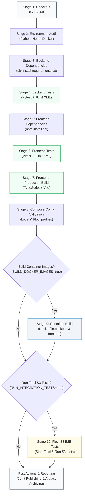

# 🚀 Jenkins CI/CD Pipeline Documentation

> **Autonomous, Production-Grade Continuous Integration & Delivery Pipeline**  
> Designed for local demonstration, academic defense, and DevOps portfolio showcase under a strict **₹0 budget**.

---

## 1. Pipeline Overview & Design Principles

The Cloud Backup System utilizes a **Declarative Jenkins Pipeline** (`Jenkinsfile`) designed to enforce rigorous software engineering quality gates without relying on paid cloud CI services (e.g., GitHub Actions, CircleCI, AWS CodePipeline).



### Key Highlights:
- **₹0 Infrastructure Cost**: Executes entirely on a local Jenkins agent (`agent any`).
- **Zero Cloud Leaks**: Never connects to real AWS, third-party APIs, or paid runners.
- **Fail-Fast Error Handling**: Strict non-zero exit code propagation ensures that any test regression immediately stops the pipeline.
- **Cross-Platform Compatibility**: Supports native execution on both Windows agents (`bat`) and Linux agents (`sh`).
- **Standardized JUnit Reporting**: Both Pytest and Vitest generate standard JUnit XML reports parsed by Jenkins' `junit` step.
- **Safe Resource Cleanup**: Uses `cleanWs` and safe container stoppage (`docker compose stop floci`). **Never** invokes destructive commands like `docker compose down -v` that could destroy user data volumes.

---

## 2. Jenkins Pipeline Stages Breakdown

| Stage | Name | Action & Quality Gate | Artifacts Produced |
| :---: | :--- | :--- | :--- |
| **1** | **Checkout** | Retrieves the latest source code from the configured Git branch. | Working tree |
| **2** | **Environment Audit** | Logs versions of Python, Node, npm, Docker, and Docker Compose without leaking secrets. | Console logs |
| **3** | **Backend Dependencies** | Installs pinned packages from `backend/requirements.txt` into the runner environment. | Python virtualenv/cache |
| **4** | **Backend Tests** | Executes 47 isolated Pytest unit and security tests. Generates JUnit XML. | `backend/reports/backend-junit.xml` |
| **5** | **Frontend Dependencies** | Installs npm dependencies reproducibly from `package.json` and `package-lock.json`. | `frontend/node_modules/` |
| **6** | **Frontend Tests** | Runs 19 Vitest dashboard component tests across 5 test suites. Generates JUnit XML. | `frontend/reports/frontend-junit.xml` |
| **7** | **Frontend Build** | Compiles TypeScript and builds production distribution assets (`tsc -b && vite build`). | `frontend/dist/` bundle |
| **8** | **Compose Config Validation** | Dry-run validates both `default` and `--profile s3` Compose configurations. | Compose schema verification |
| **9** | **Container Image Build** | Builds `cloud-backup-backend:ci` and `cloud-backup-frontend:ci` via Docker. | Local Docker images |
| **10** | **Floci S3 Integration** | *(Opt-In)* Spins up local Floci emulator container and runs live S3 lifecycle tests. | Integration test logs |
| **11** | **Summary & Cleanup** | Publishes JUnit XML test reports, archives `dist/` bundle, and cleans ephemeral workspace. | Published test trends & archives |

---

## 3. Host Prerequisites & Tools

To run this pipeline locally, ensure the following free tools are installed on your host machine:

| Tool | Recommended Version | Verification Command | Purpose |
| :--- | :--- | :--- | :--- |
| **Jenkins** | 2.450+ LTS | Service check on port `8080` | Pipeline execution engine |
| **Java (JDK)** | 17 or 21 | `java -version` | Runtime requirement for Jenkins |
| **Python** | 3.10 – 3.14 | `python --version` | Backend API runtime and pytest suite |
| **Node.js** | 20+ LTS | `node --version` | Frontend Vite compiler and Vitest runner |
| **npm** | 10+ | `npm.cmd --version` | Node package manager |
| **Docker** | 24+ / Desktop | `docker --version` | Container image builds and Floci emulation |
| **Docker Compose** | v2.20+ | `docker compose version` | Multi-container stack orchestration |
| **Git** | 2.40+ | `git --version` | SCM checkout and version control |

---

## 4. Suggested Jenkins Plugins

When setting up your local Jenkins instance, install these standard, free plugins from **Manage Jenkins &rarr; Plugins**:

1. **Pipeline** (`workflow-aggregator`): Provides Declarative Pipeline syntax.
2. **Git Plugin** (`git`): SCM checkout and branch tracking.
3. **JUnit Plugin** (`junit`): Parses `backend-junit.xml` and `frontend-junit.xml` to render test trend graphs.
4. **AnsiColor** (`ansicolor`): Displays colorized console outputs for test frameworks.
5. **Credentials Plugin** (`credentials`): Safe credential handling (not needed for basic local builds, but recommended for Git authentication).

---

## 5. Step-by-Step Setup Guide in Jenkins UI

### Step 1: Create a New Pipeline Job
1. Open your browser to Jenkins: [http://localhost:8080](http://localhost:8080).
2. Click **New Item** on the left dashboard sidebar.
3. Enter job name: `cloud-backup-system`.
4. Select **Pipeline** as the item type and click **OK**.

### Step 2: Configure General Settings & Build Parameters
In the job configuration page:
- Check **This project is parameterized**.
- Click **Add Parameter** &rarr; **Boolean Parameter**:
  - **Name**: `BUILD_DOCKER_IMAGES`
  - **Default Value**: `true` (Checked)
  - **Description**: `Build local Docker images for backend and frontend.`
- Click **Add Parameter** &rarr; **Boolean Parameter**:
  - **Name**: `RUN_INTEGRATION_TESTS`
  - **Default Value**: `false` (Unchecked)
  - **Description**: `Optionally spin up Floci local emulator and run live S3 integration tests.`

### Step 3: Configure Pipeline from SCM
Scroll down to the **Pipeline** section:
- **Definition**: Select **Pipeline script from SCM**.
- **SCM**: Select **Git**.
- **Repository URL**: Enter your Git repository path:
  - *Local path format*: `file:///C:/antigravity_projects/cloud_backup_system`
  - *Or GitHub remote format*: `https://github.com/<YOUR_USERNAME>/cloud_backup_system.git`
- **Credentials**: Leave `none` (for local file repo or public GitHub repo).
- **Branch Specifier**: `*/main`.
- **Script Path**: `Jenkinsfile`.
- Click **Save**.

### Step 4: Execute the First Build
1. In the pipeline job page, click **Build with Parameters**.
2. Select your options (or keep defaults: `BUILD_DOCKER_IMAGES=true`, `RUN_INTEGRATION_TESTS=false`).
3. Click **Build**.
4. Click on the build number (e.g. `#1`) &rarr; **Console Output** to monitor real-time execution.

---

## 6. Interpreting Test Reports & Archived Artifacts

### Test Result Trends & Historical Baselines
After a successful build:
- The job overview page renders a **Test Result Trend** graph.
- Clicking **Test Result** displays the detailed breakdown:
  - **Current Verified Suite (Phases 10 & 11)**:
    - **Backend Pytest**: **47 passed, 0 failed** (47 passed when Floci emulator is online; 45 passed, 2 skipped when Floci is offline).
    - **Frontend Vitest**: **19 passed, 0 failed** across 5 test suites.
  - **Historical Baseline (Phase 5 Pipeline Scaffolding)**:
    - Initial baseline prior to Phase 7 portable backup archives and Phase 11 live Floci verification was 29 backend tests and 14 frontend tests.
  - **Total Quality Gate**: 100% passing tests across all active stages.

### Archived Artifacts
Under the build summary:
- `backend/reports/backend-junit.xml`: Full XML report of backend test execution.
- `frontend/reports/frontend-junit.xml`: Full XML report of frontend test execution.
- `frontend/dist/**`: Compiled static production distribution bundle ready for deployment.

---

## 7. Troubleshooting & Safe Cleanup

### Safe Container Stop (Preserves Data)
If containers were left running from an integration test:
```powershell
cd c:\antigravity_projects\cloud_backup_system
docker compose stop
```

> [!CAUTION]
> **Never use `docker compose down -v` in CI scripts or maintenance.**  
> The `-v` flag purges persistent Docker volumes (`cloud_backup_floci_data` and `cloud_backup_backend_data`), deleting all user backup data and metadata.

### Windows Service PATH Considerations
If Jenkins is running as a Windows Service (`LocalSystem` account), it may not inherit your user-specific PATH variables (e.g., `npm`, `python`, or `docker`).
To resolve:
1. Ensure `python.exe`, `node.exe`, and `docker.exe` are in the **System PATH** environment variable (not just User PATH).
2. Restart the Jenkins service via PowerShell:
   ```powershell
   Restart-Service Jenkins
   ```
