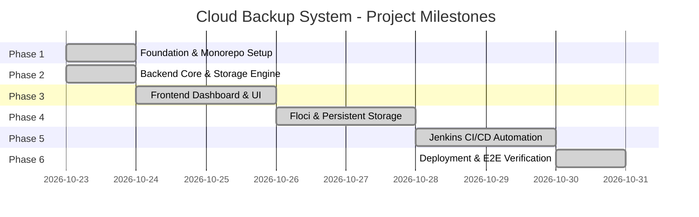

# Phased Development Roadmap

This document outlines the phased milestone progression for the **Cloud Backup System** college project. Every phase adheres strictly to the ₹0 budget mandate.

---

## Phase Breakdown

---

### Phase 1: Workspace Foundation & Baseline Standards (Completed)
- [x] Inspect root workspace and establish clean Git repository.
- [x] Create monorepo folder layout (`frontend/`, `backend/`, `docs/`, `docker/`).
- [x] Author comprehensive root `.gitignore` protecting secrets, virtual environments, node modules, and SQLite files.
- [x] Provide root, backend, and frontend `.env.example` templates.
- [x] Author technical architecture with Mermaid diagrams.
- [x] Lay down root `Jenkinsfile` skeleton for future local CI pipeline.
- [x] Establish minimal backend application scaffold (FastAPI health router, storage interface ABC).
- [x] Establish minimal frontend workspace configuration (Vite, TypeScript, Tailwind design tokens).

---

### Phase 2: Backend Core & Storage Engine (Completed)
- [x] SQLite database schema modeling `files`, `file_versions`, `backups`, and `backup_items` with foreign keys and WAL mode.
- [x] Implement `LocalFileSystemStorage` driver with path traversal prevention and atomic writing.
- [x] Implement optional `S3CompatibleStorage` driver using `boto3` for MinIO / LocalStack compatibility.
- [x] MinIO licensing analysis: verified AGPLv3 vs. commercial editions, zero-budget ₹0 guarantee, and SeaweedFS/LocalStack alternatives.
- [x] Implement file upload endpoint (`POST /api/v1/files/upload`) with SHA-256 calculation, unique immutable object keys, and version preservation.
- [x] Implement file listing (`GET /api/v1/files`) with substring search and pagination.
- [x] Implement file download (`GET /api/v1/files/{file_id}/download`) with ETag, Content-Disposition, and support for downloading historical versions.
- [x] Implement file version history (`GET /api/v1/files/{file_id}/versions`) and point-in-time restore (`POST /api/v1/files/{file_id}/restore/{version_id}`).
- [x] Implement file deletion (`DELETE /api/v1/files/{file_id}`) with physical object cleanup across all versions.
- [x] Implement storage metrics endpoint (`GET /api/v1/storage/stats`) with masked paths.
- [x] Implement backup snapshot trigger (`POST /api/v1/backups/trigger`) and audit history log (`GET /api/v1/backups/history`).
- [x] Comprehensive pytest test suite with 25 passing unit and integration tests using isolated temporary databases and storage directories.

---

### Phase 3: Frontend Implementation & Dashboard UI (Completed)
- [x] Centralized typed API service (`frontend/src/services/api.ts`) matching FastAPI Pydantic response schemas.
- [x] Full TypeScript definitions (`frontend/src/types/index.ts`) matching backend contracts.
- [x] Responsive Cloud Backup dashboard UI with dark navy typography, light canvas, and emerald accents.
- [x] Top navigation bar (`Navbar.tsx`) with real backend health heartbeat, ₹0 budget badge, and storage provider indicator.
- [x] Real-time storage metrics overview cards (`StorageStatsCard.tsx`) tracking capacity usage, quota progress, files, and versions.
- [x] Drag-and-drop file upload zone (`UploadArea.tsx`) with size validation, reserved name checking, version notes, and toast alerts.
- [x] File inventory table (`FileList.tsx`) with search, pagination, version badges, SHA-256 copyable checksums, download, and delete actions.
- [x] Accessible confirmation modal (`ConfirmModal.tsx`) for destructive file deletion and version rollback actions.
- [x] Version history slide-over drawer (`VersionDrawer.tsx`) to inspect immutable past versions, download any version, and restore previous versions.
- [x] System backup snapshot tab (`BackupSnapshots.tsx`) to trigger point-in-time snapshots and view audit history.
- [x] Vite reverse proxy (`vite.config.ts`) configured to eliminate CORS during local development.
- [x] Vitest and React Testing Library test suites (14 tests across 4 test suites passing).

---

### Phase 4: Floci Integration, Docker Compose & Persistent Storage (Completed)
- [x] Official Floci (`floci/floci:2.3.0`, MIT License, ₹0 budget) local AWS emulator verified on port 4566.
- [x] Verified Floci persistence configuration (`FLOCI_STORAGE_MODE=persistent`, `FLOCI_STORAGE_PERSISTENT_PATH=/app/data`).
- [x] Configured `S3CompatibleStorage` driver with path-style addressing and idempotent bucket creation.
- [x] Verified that failure to reach S3 does not silently fallback to local storage; explicit error propagation.
- [x] Verified data persistence across Floci container restarts using named Docker volume `cloud_backup_floci_data`.
- [x] Multi-stage production `Dockerfile.backend` (Python 3.12 slim, health check, uvicorn).
- [x] Multi-stage production `Dockerfile.frontend` (Node 20 alpine + Nginx 1.27 alpine reverse proxy).
- [x] Author root `docker-compose.yml` supporting default local filesystem mode and `--profile s3` Floci mode.
- [x] Validated `docker compose config` and `docker compose --profile s3 config`.
- [x] Comprehensive pytest test suite with mocked S3 unit tests and live Floci integration test.
- [x] Updated root `Jenkinsfile` for local cross-platform build validation and unit testing.

---

### Phase 5: Containerization Hardening & Local Jenkins CI/CD (Completed)
- [x] Author robust root `Jenkinsfile` with 11 declarative pipeline stages: Checkout, Environment Validation, Backend Dependencies, Backend Tests, Frontend Dependencies, Frontend Tests, Frontend Build, Docker Compose Validation, Container Image Build, Floci Integration Tests (Opt-in), and Post Actions / Cleanup.
- [x] Implement cross-platform pipeline steps (`isUnix() ? sh(...) : bat(...)`) supporting native Windows Jenkins services and Linux Docker/agent runners.
- [x] Configure JUnit test reporting for backend pytest (`reports/backend-junit.xml`) and frontend Vitest (`reports/frontend-junit.xml`) with failure preservation (`catchError(buildResult: 'FAILURE', stageResult: 'FAILURE')`).
- [x] Configure production frontend Vite/TypeScript build verification and artifact archiving (`frontend/dist/**`).
- [x] Validate Docker Compose specifications for both standalone local mode and multi-container `--profile s3` Floci mode without requiring running services.
- [x] Configure container image builds for backend (`cloud-backup-backend:ci`) and frontend (`cloud-backup-frontend:ci`) gated by `BUILD_DOCKER_IMAGES` parameter.
- [x] Configure opt-in Floci S3 emulator integration testing gated by `RUN_INTEGRATION_TESTS` parameter with safe container lifecycle management (`docker compose stop floci`) avoiding destructive volume wipes.
- [x] Maintain strict zero-budget compliance: ₹0 cost, no GitHub Actions, no paid cloud services, and no real AWS dependencies.
- [x] Author comprehensive Jenkins operational guide in `docs/jenkins-ci-cd.md` detailing architecture, tool requirements, plugin setup, pipeline creation, and troubleshooting.

---

### Phase 6: Deployment Readiness, Backup Auditing & End-to-End Verification (Completed)
- [x] Application startup review: verified zero-dependency local filesystem mode, verified S3/Floci endpoint fail-fast behavior, validated SQLite initialization, and created safe Windows PowerShell startup script (`scripts/start-local.ps1`).
- [x] Comprehensive backup and restore architecture audit: determined snapshot structure (relational manifest, version references, SHA-256 hashes, deterministic aggregate checksum; clarified that physical blobs are not bundled and metadata-only snapshots are not complete disaster-recovery backups).
- [x] Added automated tests for snapshot manifest integrity, empty catalog snapshotting, deleted file exclusion, and clean 404 error handling for missing physical storage objects (`backend/tests/test_backups.py`).
- [x] Created complete 10-step End-to-End automated smoke test suite in pytest (`backend/tests/test_smoke_e2e.py`) verifying health, upload, listing, download verification, versioning, rollback, snapshotting, deletion, and storage provider failure handling.
- [x] Created standalone Windows PowerShell smoke test workflow (`scripts/smoke-test.ps1`) for live server validation without mutating user data or persistent databases.
- [x] Security and reliability review: verified path traversal boundaries, Windows reserved name sanitization, payload size limits, CORS restrictions, and localhost port bindings.
- [x] Documentation updates: detailed PowerShell workflows, local and Floci modes, backup semantics and limitations, troubleshooting guide, and accurate Jenkins execution status in `README.md`.

---

### Phase 7: Independently Restorable Backup Archives (Completed)
- [x] Architecture design: implemented portable backup archive specification using Python standard library (`zipfile`, `hashlib`, `json`) with root `manifest.json` (v1.0.0) and uncompressed/compressed raw binary payloads in `blobs/{version_id}_{safe_filename}`.
- [x] Archive export service (`GET/POST /api/v1/archives/export`): bundles active files and complete historical versions, generates cryptographic SHA-256 hashes, safe relative paths, and metadata. Policy on missing blobs: explicitly raises `409 Conflict` rather than silently omitting required files.
- [x] Archive verification service (`POST /api/v1/archives/verify`): dry-run inspection validating ZIP limits (100 MB archive size, 250 MB uncompressed size, 1,000 max entries, 100:1 max ratio), rejecting path traversal and Windows reserved device names, checking format version, and recalculating SHA-256 checksums of every payload blob without mutating system state.
- [x] Archive restore service (`POST /api/v1/archives/restore`): pre-verifies archive integrity, generates new isolated internal system UUIDs and storage keys (never trusts archive identifiers), restores files via the configured `StorageProvider` abstraction layer (supporting local disk and Floci S3), and handles filename collisions via user-selected conflict strategies (`rename` [default], `skip`, `replace`). Storage rollback on database failures.
- [x] Full automated test coverage (`backend/tests/test_archives.py`): 9 automated tests verifying multi-version export, checksum verification, corrupted blob detection, path traversal rejection, Windows reserved name rejection, 409 missing source object failure, isolated environment recovery, collision strategies (`rename` & `skip`), and coexistence with Phase 2 snapshot manifests.
- [x] Frontend dashboard integration (`frontend/src/components/BackupSnapshots.tsx`): added "Portable Archives (.zip)" sub-view with Export Archive, Verify Archive inspection card, and Restore Archive card with conflict selector, safety confirmation, and reactive state sync. Added 5 Vitest tests (`frontend/tests/BackupArchives.test.tsx`).
- [x] Complete zero-budget compliance: ₹0 budget maintained, standard library implementation, no paid cloud services, and preserved existing SQLite snapshots and file management untouched.

