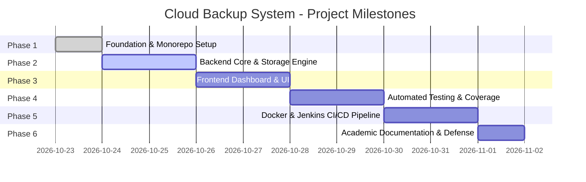

# Phased Development Roadmap

This document outlines the phased milestone progression for the **Cloud Backup System** college project. Every phase adheres strictly to the ₹0 budget mandate.

---

## Phase Breakdown

---

### Phase 1: Workspace Foundation & Baseline Standards (Current)
- [x] Inspect root workspace and establish clean Git repository.
- [x] Create monorepo folder layout (`frontend/`, `backend/`, `docs/`, `docker/`).
- [x] Author comprehensive root `.gitignore` protecting secrets, virtual environments, node modules, and SQLite files.
- [x] Provide root, backend, and frontend `.env.example` templates.
- [x] Author technical architecture with Mermaid diagrams.
- [x] Lay down root `Jenkinsfile` skeleton for future local CI pipeline.
- [x] Establish minimal backend application scaffold (FastAPI health router, storage interface ABC).
- [x] Establish minimal frontend workspace configuration (Vite, TypeScript, Tailwind design tokens).

---

### Phase 2: Backend Core & Storage Engine
- [ ] SQLite database initialization with schema migrations for `files` and `backups`.
- [ ] Implement `LocalFileSystemStorage` driver fulfilling `StorageProvider` abstract base class.
- [ ] Implement file upload endpoint (`POST /api/v1/files/upload`) with SHA-256 calculation and UUID naming.
- [ ] Implement file listing (`GET /api/v1/files`) and file download (`GET /api/v1/files/{file_id}/download`).
- [ ] Implement file deletion (`DELETE /api/v1/files/{file_id}`) with disk cleanup.
- [ ] Implement storage metrics endpoint (`GET /api/v1/storage/stats`).
- [ ] Implement backup snapshot trigger (`POST /api/v1/backups/trigger`) and history log (`GET /api/v1/backups/history`).

---

### Phase 3: Frontend Implementation & Dashboard UI
- [ ] Configure Tailwind CSS design tokens: clean light background, dark navy typography (`#0f172a`), emerald accents (`#10b981`).
- [ ] Build reusable UI components: Stat cards, modal dialogs, status badges, toast notifications.
- [ ] Build drag-and-drop file upload zone with upload progress indicators.
- [ ] Build interactive files table with search, sorting, and single-click download/delete actions.
- [ ] Build storage statistics panel with capacity usage bar and file distribution breakdown.
- [ ] Build backup history audit view with manual trigger action button.
- [ ] Connect frontend to FastAPI backend using typed API client.

---

### Phase 4: Automated Testing & Verification
- [ ] Backend test suite with `pytest`:
  - Storage provider unit tests (saving, retrieving, deleting files).
  - API endpoint integration tests using `httpx.AsyncClient`.
  - Database schema and relationship tests.
- [ ] Frontend unit & component tests using `Vitest` and `React Testing Library`.
- [ ] End-to-end user journey test (Upload -> View in table -> Check stats -> Trigger backup -> Download file).

---

### Phase 5: Containerization & Local Jenkins CI/CD
- [ ] Create production-ready `Dockerfile` for backend (multi-stage Python runtime).
- [ ] Create production-ready `Dockerfile` for frontend (multi-stage Vite build + Nginx alpine).
- [ ] Author `docker-compose.yml` linking frontend, backend, and shared local volume.
- [ ] Configure local Jenkins pipeline via `Jenkinsfile`:
  - Automated checkout.
  - Dependency installation.
  - Backend `pytest` suite execution.
  - Frontend typecheck and `vitest` execution.
  - Docker Compose build verification.

---

### Phase 6: Final Hardening, Submission Documentation & Demo Preparation
- [ ] Prepare comprehensive Project Report (PDF/Markdown format) meeting college submission standards.
- [ ] Add Resume Showcase Section: architecture highlights, key technical decisions, zero-budget engineering.
- [ ] Create step-by-step presentation script & video demonstration guide.
- [ ] Final security audit (input sanitization, path traversal checks, secret masking).
