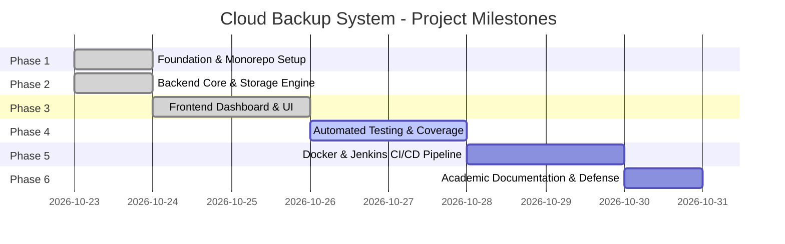

# Phased Development Roadmap

This document outlines the phased milestone progression for the **Cloud Backup System** college project. Every phase adheres strictly to the ₹0 budget mandate.

---

## Phase Breakdown

---

### Phase 1: Workspace Foundation & Baseline Standards (Completed)
- [x] Inspect root workspace and establish clean Git repository.
- [x] Create monorepo folder layout (`frontend/`, `backend/`, `docs/`, `docker/`).
- [x] Author comprehensive root `.gitignore` protecting secrets, virtual environments, node modules, and SQLite files.
- [x] Provide root, backend, and frontend `.env.example` templates.
- [x] Author technical architecture with Mermaid diagrams.
- [x] Lay down root `Jenkinsfile` skeleton for future local CI pipeline.
- [x] Establish minimal backend application scaffold (FastAPI health router, storage interface ABC).
- [x] Establish minimal frontend workspace configuration (Vite, TypeScript, Tailwind design tokens).

---

### Phase 2: Backend Core & Storage Engine (Completed)
- [x] SQLite database schema modeling `files`, `file_versions`, `backups`, and `backup_items` with foreign keys and WAL mode.
- [x] Implement `LocalFileSystemStorage` driver with path traversal prevention and atomic writing.
- [x] Implement optional `S3CompatibleStorage` driver using `boto3` for MinIO / LocalStack compatibility.
- [x] MinIO licensing analysis: verified AGPLv3 vs. commercial editions, zero-budget ₹0 guarantee, and SeaweedFS/LocalStack alternatives.
- [x] Implement file upload endpoint (`POST /api/v1/files/upload`) with SHA-256 calculation, unique immutable object keys, and version preservation.
- [x] Implement file listing (`GET /api/v1/files`) with substring search and pagination.
- [x] Implement file download (`GET /api/v1/files/{file_id}/download`) with ETag, Content-Disposition, and support for downloading historical versions.
- [x] Implement file version history (`GET /api/v1/files/{file_id}/versions`) and point-in-time restore (`POST /api/v1/files/{file_id}/restore/{version_id}`).
- [x] Implement file deletion (`DELETE /api/v1/files/{file_id}`) with physical object cleanup across all versions.
- [x] Implement storage metrics endpoint (`GET /api/v1/storage/stats`) with masked paths.
- [x] Implement backup snapshot trigger (`POST /api/v1/backups/trigger`) and audit history log (`GET /api/v1/backups/history`).
- [x] Comprehensive pytest test suite with 25 passing unit and integration tests using isolated temporary databases and storage directories.

---

### Phase 3: Frontend Implementation & Dashboard UI (Completed)
- [x] Centralized typed API service (`frontend/src/services/api.ts`) matching FastAPI Pydantic response schemas.
- [x] Full TypeScript definitions (`frontend/src/types/index.ts`) matching backend contracts.
- [x] Responsive Cloud Backup dashboard UI with dark navy typography, light canvas, and emerald accents.
- [x] Top navigation bar (`Navbar.tsx`) with real backend health heartbeat, ₹0 budget badge, and storage provider indicator.
- [x] Real-time storage metrics overview cards (`StorageStatsCard.tsx`) tracking capacity usage, quota progress, files, and versions.
- [x] Drag-and-drop file upload zone (`UploadArea.tsx`) with size validation, reserved name checking, version notes, and toast alerts.
- [x] File inventory table (`FileList.tsx`) with search, pagination, version badges, SHA-256 copyable checksums, download, and delete actions.
- [x] Accessible confirmation modal (`ConfirmModal.tsx`) for destructive file deletion and version rollback actions.
- [x] Version history slide-over drawer (`VersionDrawer.tsx`) to inspect immutable past versions, download any version, and restore previous versions.
- [x] System backup snapshot tab (`BackupSnapshots.tsx`) to trigger point-in-time snapshots and view audit history.
- [x] Vite reverse proxy (`vite.config.ts`) configured to eliminate CORS during local development.
- [x] Vitest and React Testing Library test suites (14 tests across 4 test suites passing).

---

### Phase 4: Automated Testing & Verification
- [ ] Frontend unit & component tests using `Vitest` and `React Testing Library`.
- [ ] End-to-end integration tests (Upload -> View in table -> Check stats -> Trigger backup -> Download file -> Restore previous version).

---

### Phase 5: Containerization & Local Jenkins CI/CD
- [ ] Create production-ready `Dockerfile` for backend (multi-stage Python runtime).
- [ ] Create production-ready `Dockerfile` for frontend (multi-stage Vite build + Nginx alpine).
- [ ] Author `docker-compose.yml` linking frontend, backend, and optional local MinIO container.
- [ ] Configure local Jenkins pipeline via `Jenkinsfile` for automated build and test quality gates.

---

### Phase 6: Final Hardening, Submission Documentation & Demo Preparation
- [ ] Prepare comprehensive Project Report (PDF/Markdown format) meeting college submission standards.
- [ ] Add Resume Showcase Section: architecture highlights, key technical decisions, zero-budget engineering.
- [ ] Create presentation script & video demonstration guide.
